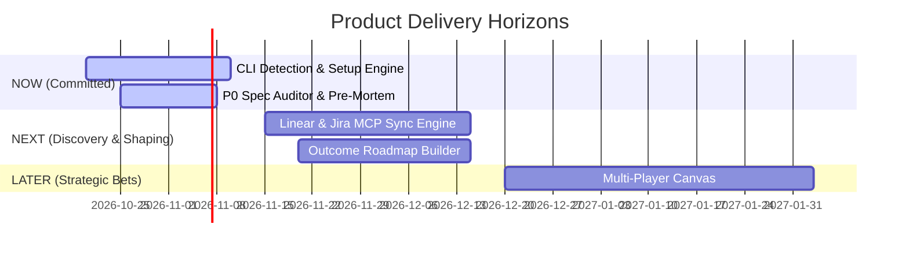

# 🗺️ Generate Outcome Roadmap Skill

## Overview
The `create-roadmap` skill eliminates the toxic anti-pattern of rigid, feature-stuffed Gantt charts with false delivery dates. By analyzing `BACKLOG.md`, `.context/discovery.md`, and prioritized frameworks (RICE, ICE, WSJF, Opportunity Scoring), it generates an executive-ready, outcome-driven roadmap structured as either a **Now / Next / Later** progression or a **Quarterly OKR Outcome Horizon**.

---

## ⚙️ Supported Roadmap Formats
1. **⏳ Now / Next / Later Horizon (Default / Agile)**:
   - **Now**: Actively committed sprint items with high certainty and detailed specs (`docs/`).
   - **Next**: Validated customer problems currently being shaped, staffed, or tested with prototypes.
   - **Later**: Strategic directions, unvalidated opportunities, and long-term bets under continuous discovery.
2. **🎯 Quarterly OKR Outcome Roadmap (Enterprise / Portfolio)**:
   - Organized by business quarters (Q1, Q2, Q3) and explicitly anchored to quantitative target outcomes rather than static feature commitments.

---

## 📋 Best Practices & Standards Enforced
- **Outcome over Output**: Every roadmap initiative is paired with a measurable business or customer outcome, not just a feature name.
- **Explicit Uncertainty Gradient**: Certainty decreases progressively from Now (90% confidence) to Later (30% confidence).
- **Grounding in Backlog Truth**: Every initiative reflects real prioritized items in `BACKLOG.md` or `.context/discovery.md`.
- **Constraint Visibility**: Explicitly states dependencies, team capacity limits, and external blockers.

---

## 🛠️ Standardized 4-Stage Execution Protocol

### Stage 1: Context Hydration
1. Ingest [`.context/product.md`](file:///home/marcin/Documents/Projects/ai-pm-sidekick/.context/product.md) for overarching North Star metrics, current OKRs, and target customer segments.
2. Ingest [`.context/strategy-and-constraints.md`](file:///home/marcin/Documents/Projects/ai-pm-sidekick/.context/strategy-and-constraints.md) for system bottlenecks, capacity limits, and strategic pillars.
3. Ingest [`.context/discovery.md`](file:///home/marcin/Documents/Projects/ai-pm-sidekick/.context/discovery.md) for scored customer opportunities and assumption tests.
4. Ingest [`BACKLOG.md`](file:///home/marcin/Documents/Projects/ai-pm-sidekick/BACKLOG.md) for active epics, sprint tasks, and unprioritized backlog items.

### Stage 2: Socratic Clarifying Gate
1. **Format Selection**: Confirm whether the user prefers **Now / Next / Later** (recommended for continuous delivery) or **Quarterly OKR** (for executive/board presentations).
2. **Time Horizon**: Inquire if there are specific enterprise contract deadlines or board commitments that must anchor the schedule.

### Stage 3: Grounded Generation
Generate the comprehensive Outcome Roadmap deliverable:

```markdown
# 🗺️ Product Outcome Roadmap — [Product Name / Year]

### 🎯 Strategic North Star Alignment
- **North Star Metric**: [Metric Name from product.md]
- **Target Horizon**: [Current Quarter / Next 2 Quarters]

---

## ⏳ Now / Next / Later Horizon

### 🟢 NOW (Committed / High Certainty — Current Sprint to 4 Weeks)
*Focus: Flawless execution and delivery of validated specifications.*
- **[Epic 1: Real-time CLI Auto-Detection]**
  - **Target Outcome**: Reduce time-to-first-token from 12 mins to $< 30$ seconds.
  - **Metric Impact**: Onboarding completion jumps from 18% to $> 45\%$.
  - **Status / Spec**: PRD approved in `docs/prds/cli_detection_prd.md`; Sprint 4.
  - **Key Risks / Dependencies**: Node/Python PATH variance across Linux/macOS.

### 🟡 NEXT (Shaping & Validating — 1 to 3 Months Out)
*Focus: Solution discovery, prototyping, and technical de-risking.*
- **[Epic 2: Bi-directional Linear & Jira MCP Sync]**
  - **Target Outcome**: Eliminate double-entry between local markdown files and issue trackers.
  - **Metric Impact**: Weekly active retention increases by $+15\%$.
  - **Status / Spec**: Assumption mapping in progress; RAT prototype active.
  - **Key Dependencies**: Atlassian & Linear OAuth2 API rate limits.

### 🔵 LATER (Exploring / High Uncertainty — 3+ Months Out)
*Focus: Strategic opportunities and problem discovery.*
- **[Epic 3: Multi-Player Real-Time Collaborative Canvas]**
  - **Target Outcome**: Enable cross-functional PM-Design-Engineering co-authoring.
  - **Metric Impact**: Viral K-factor improves from $0.12$ to $> 0.40$.
  - **Status / Spec**: Opportunity scoring validated; awaiting core workflow stabilization.

---

## 📊 Visual Roadmap Progression (Mermaid)


```

### Stage 4: Knowledge Compounding (Write-Back)
1. Save the roadmap to `docs/roadmap/outcome_roadmap_[current_period].md`.
2. Offer to update [`.context/discovery.md`](file:///home/marcin/Documents/Projects/ai-pm-sidekick/.context/discovery.md) and [`BACKLOG.md`](file:///home/marcin/Documents/Projects/ai-pm-sidekick/BACKLOG.md) to align ticket states with the roadmap horizons.

---

## 🔄 Flow Handling & Suggested Next Skills
- **Present to Leadership**: Prepare a defense brief with `prep-meeting`.
- **Break Down 'Now' Items**: Slice immediate epics with `create-user-stories` or `frameworks/operations/user-story-mapping.md`.
- **Validate 'Next' Items**: Design quick tests with `frameworks/discovery/assumption-mapping.md`.
