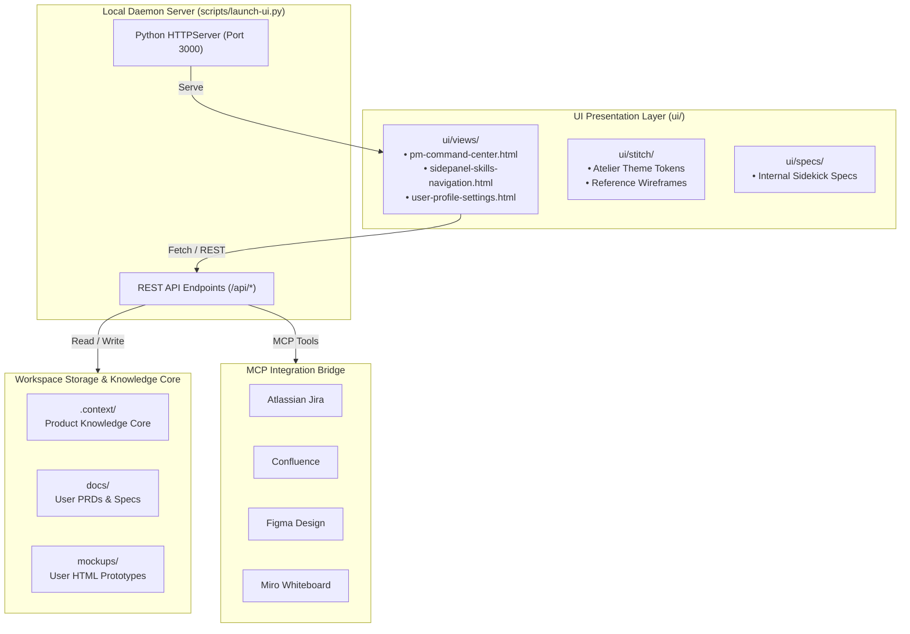

# 🏛️ Product Knowledge Core — Architecture & Technical Context (`architecture.md`)

This document defines the architectural boundaries, technology stack, entity data models, and API interfaces for the workspace. In `standalone` mode, it documents the Sidekick harness and its integration endpoints; in `embedded` mode, it is automatically pre-populated with the host codebase's stack and manifest details.

---

## ⚙️ 1. System Mode & Architectural Overview

- **Operating Mode**: `standalone` (Dedicated PM Command Center Workspace)
- **Host Environment**: Linux / macOS / Windows with Python 3.8+
- **Architectural Pattern**: Local-First, Zero-Dependency Server & Static Frontend with MCP Protocol Bridge



---

## 💻 2. Technology Stack

| Layer | Component / Tool | Version / Standard | Purpose |
| :--- | :--- | :--- | :--- |
| **Backend & CLI** | Python Standard Library | Python 3.8+ | Zero-dependency server (`launch-ui.py`), skill exporter (`export-skills.py`), workspace initializer (`init-workspace.py`). |
| **Frontend UI** | Google Stitch Atelier UI | Vanilla HTML5 / ES6 | Fast, lightweight UI dashboard with zero Node build steps. |
| **Styling** | Tailwind CSS CDN | v3.4+ | Utility-first dark/light responsive design. |
| **Markdown Rendering**| `marked.js` | v12.0+ (CDN) | Client-side dual-pane live preview of PRDs, Gherkin specs, and tables. |
| **Tool Protocols** | Model Context Protocol (MCP)| Specification 2024-11 | Standardized communication with Jira, Confluence, Figma, and Miro. |
| **AI Tool Support** | AGY, Claude Code, Cursor | Native skill formats | Cross-exported rules (`.cursor/rules/`), commands (`.claude/commands/`), skills (`.agents/skills/`). |

---

## 📊 3. Core Data Models & Schemas

### 1. Harness Configuration (`.context/harness-config.yaml`)
```yaml
mode: standalone | embedded
default_tier: lean | standard | enterprise
favorite_skills: string[]
active_frameworks: string[]
mcp_enabled: string[]
```

### 2. Product Artifact (`get_all_artifacts`)
```json
{
  "filename": "checkout_flow_prd.md",
  "path": "docs/checkout_flow_prd.md",
  "size_bytes": 14205,
  "size_kb": 13.9,
  "modified_iso": "2026-10-14 10:15",
  "type": "PRD | Spec | Mockup | Backlog"
}
```

### 3. User Settings & MCP Credentials (`.env`)
```env
USER_NAME="Paula (Lead PM)"
USER_EMAIL="paula.pm@company.com"
DEFAULT_PERSONA="paula"
DEFAULT_PRD_MODE="standard"
DEFAULT_AC_FORMAT="gherkin"
DEFAULT_STORY_SCALE="fibonacci"
DEFAULT_UI_THEME="stitch"
ATLASSIAN_HOST="https://domain.atlassian.net"
ATLASSIAN_EMAIL="paula.pm@company.com"
ATLASSIAN_API_TOKEN="secret_token"
FIGMA_ACCESS_TOKEN="secret_token"
MIRO_ACCESS_TOKEN="secret_token"
STITCH_API_KEY="secret_key"
```

---

## 🌐 4. API Boundaries & REST Endpoints

The internal server (`scripts/launch-ui.py`) exposes the following local endpoints on `http://127.0.0.1:3000`:

| Endpoint | Method | Parameters / Body | Description |
| :--- | :--- | :--- | :--- |
| `/` | `GET` | - | Serves the PM Command Center UI (`ui/views/pm-command-center.html`). |
| `/api/skills` | `GET` | - | Returns array of all available canonical skills with categories and descriptions. |
| `/api/artifacts` | `GET` | - | Returns live list of user deliverables in `docs/` and `mockups/` (excluding internal assets). |
| `/api/artifact-content` | `GET` | `?file=<relative_path>` | Fetches raw file text or HTML content for live dual-pane preview. |
| `/api/mcp-status` | `GET` | - | Inspects `.env` and returns connection status for Atlassian, Figma, Miro, and Stitch. |
| `/api/user-settings` | `GET` | - | Returns active user preferences, persona defaults, and credential masking. |
| `/api/user-settings` | `POST`| `{ user_name, persona, ... }` | Updates `.env` configuration file safely on disk. |
| `/api/test-mcp` | `POST`| `{ "target": "atlassian" }` | Validates credentials for specific MCP target service. |
| `/api/generate-deliverable` | `POST`| `{ skill, feature_name, mode, requirements }` | Renders template into `docs/<feature>_<skill>.md` with instant live preview. |

---

## 📂 5. Workspace Isolation Boundaries

To guarantee complete separation of concerns and eliminate LLM hallucinations:
- **`ui/` (Harness Infrastructure)**: Internal app views (`ui/views/`), design assets (`ui/stitch/`), and Sidekick specifications (`ui/specs/`). Ingested only when working *on* the Sidekick tool itself.
- **`docs/` (User Product Specs)**: Exclusively reserved for PRDs, INVEST stories, and design briefs generated *for the product under management*.
- **`mockups/` (User Product Prototypes)**: Exclusively reserved for clickable HTML wireframes created by `/create-mockup`.
- **`.context/` (Product Knowledge Core)**: The shared single source of truth defining vision, outcomes, strategy, and conventions.
