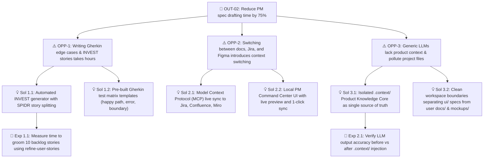

# 🔍 Product Knowledge Core — Discovery & Outcomes (`discovery.md`)

This document captures continuous product discovery findings, including active business outcomes, the Opportunity Solution Tree (OST), customer interview evidence synthesized using **The Mom Test**, and **Jobs to Be Done (JTBD)** canvases.

---

## 🎯 1. Active Outcomes

| Outcome ID | Level | Metric / Goal | Target Window | Status | Owner |
| :--- | :--- | :--- | :--- | :--- | :--- |
| **OUT-01** | Business Outcome | Increase sprint velocity and feature throughput by 30% | Q1 / Q2 | Active | Paula |
| **OUT-02** | Product Outcome | Reduce time spent by PMs drafting and formatting PRDs/tickets by 75% | Q1 | Active | Paula |
| **OUT-03** | Quality Outcome | Reduce ticket clarification questions raised during engineering development to $< 1$ per story | Ongoing | In Progress | Eric |

---

## 🌳 2. Opportunity Solution Tree (OST)

### Opportunity Log:
1. **OPP-1: Writing Gherkin edge cases & INVEST stories takes hours**
   - *Customer Need*: PMs need stories that QA and Engineering can execute immediately without circular back-and-forth discussions.
   - *Target Solution*: `create-user-stories` and `refine-user-stories` with automated Grooming Readiness scoring.
2. **OPP-2: Multi-tool synchronization friction**
   - *Customer Need*: Once specs are approved, copy-pasting into Jira epics and Confluence pages is tedious and error-prone.
   - *Target Solution*: Live MCP synchronization via `sync-jira` and `sync-confluence`.
3. **OPP-3: AI context contamination & hallucinated architecture**
   - *Customer Need*: AI agents often mix up internal UI components with user product artifacts, or hallucinate database schemas.
   - *Target Solution*: Strict file boundaries (`ui/` vs `docs/`/`mockups/`) and machine-readable `.context/architecture.md`.

---

## 🗣️ 3. The Mom Test — Customer Interview Evidence

> **The Mom Test Core Rules**:
> 1. Talk about their life, workflow, and past actions—never your hypothetical idea.
> 2. Ask about specific events that happened in the past, not opinions or predictions about the future.
> 3. Listen more than you speak; actively look for customer commitment and actual budget/time spent trying to solve it.

### Qualitative Interview Log:

| Interviewee | Segment | Observed Past Behavior & Quote | Actual Workaround Used | Verified Pain Intensity |
| :--- | :--- | :--- | :--- | :--- |
| **PM #1 (Growth Lead)** | Series A Fintech | *"Last sprint, 4 stories were blocked mid-flight because nobody specified what happens when the payment provider returns an HTTP 504 timeout."* | Maintained manual checklist in Notion; spent 3 hours in emergency grooming. | High (direct sprint spillover) |
| **PM #2 (Senior PM)** | B2B SaaS | *"I spent 45 minutes copy-pasting tables from Google Docs into Jira Cloud because Jira markdown formatting broke all the columns."* | Wrote custom bookmarklet; still had to re-link tickets manually. | High (repetitive administrative tax) |
| **PM #3 (Founder PM)** | Seed Stage | *"I tried using ChatGPT for PRDs, but it keeps generating 10-page generic documents that engineers refuse to read."* | Switched back to messy Slack bullet points. | High (lack of tailored tiering) |

---

## 📦 4. Jobs to Be Done (JTBD) Canvas

### Primary Job:
> **When** I am preparing a new feature for sprint planning,  
> **I want to** transform high-level requirements into INVEST-compliant stories with complete Gherkin acceptance criteria,  
> **So that I can** get immediate engineering sign-off, avoid mid-sprint scope rework, and keep my product roadmap aligned.

### Job Dimensions:
- **Functional Job**: Generate accurate PRDs, user stories, and wireframes that adhere to engineering standards.
- **Emotional Job**: Feel confident that no critical edge case or compliance rule was forgotten.
- **Social Job**: Be perceived by engineering and design peers as an articulate, technically grounded, and organized PM partner.

### Forces of Progress:
- **Push of Current Situation**: Frustration with tedious ticket writing, endless grooming debates, and manual copy-pasting across tools.
- **Pull of AI PM Sidekick**: Promise of instant INVEST story generation, live dual-pane preview, and 1-click Jira/Confluence MCP push.
- **Anxiety of New Solution**: Fear of AI generating hallucinated or irrelevant requirements that mislead developers. *(Mitigated by `.context/` grounding and Grooming Readiness Scores)*.
- **Habit of the Present**: Continuing to write quick, incomplete bullet points in Slack or Notion. *(Addressed by Lean mode speed)*.
