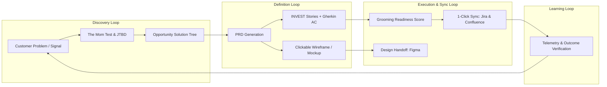

# 🧭 Product Knowledge Core — Product Context (`product.md`)

This document defines the high-level strategic identity, user personas, value loops, North Star metric, and quarterly OKRs for the product. It serves as the primary context ingested by AI skills when generating PRDs, epics, and user stories.

---

## 🌟 1. Product Vision & Mission

### Vision
To empower product teams to eliminate the friction between continuous customer discovery and engineering execution by establishing an autonomous, context-aware AI PM Sidekick that operates natively alongside their tools.

### Mission
Provide a local-first, privacy-respecting product management operating system that structures product thinking, continuously enforces quality conventions (INVEST, Gherkin BDD, ToC, OST), and automates synchronization with Jira, Confluence, Figma, and Miro.

---

## 👥 2. Target Personas

### Primary Persona: Paula (Lead Product Manager)
- **Role & Context**: Lead PM at a Series B growth startup managing 2 squad cross-functional teams.
- **Goals**:
  - Quickly translate messy discovery notes and user interviews into actionable, well-structured PRDs.
  - Break down features into engineering-ready INVEST user stories with precise Gherkin acceptance criteria without spending entire afternoons writing tickets.
  - Keep Jira, Confluence, and design briefs synchronized effortlessly.
- **Pains & Frustrations**:
  - Context contamination: AI tools mixing up system internal instructions with product requirements.
  - Jira ticket boilerplate exhaustion and inconsistent team Definition of Ready.
  - Spec churn: documentation drifting away from actual sprint implementation.
- **Key Triggers**:
  - Starting a new quarterly initiative or product discovery cycle.
  - Sprint grooming meetings where stories lack acceptance criteria or edge cases.

### Secondary Persona: Eric (Engineering Tech Lead)
- **Role & Context**: Staff Engineer / Squad Tech Lead collaborating closely with PMs.
- **Goals**:
  - Receive unambiguous requirements with clear edge cases, error states, and performance constraints.
  - Prevent scope creep and mid-sprint requirement surprises.
- **Pains**:
  - Vague ticket descriptions ("make it work smoothly").
  - Lack of architectural context and non-functional requirements (NFRs) in tickets.

### Secondary Persona: Gina (Growth PM / Founder)
- **Role & Context**: Fast-moving early-stage founder or Growth PM testing quick hypotheses.
- **Goals**:
  - 1-page Lean PRDs and clickable prototypes to test hypotheses in hours instead of weeks.
  - Rapid Mom Test interview validation before committing engineering resources.

---

## 🔁 3. Core Value Loops

### The 4 Flywheel Loops:
1. **Continuous Discovery Loop**: Incoming customer pains and qualitative feedback are mapped into the Opportunity Solution Tree (OST) and validated via Mom Test rules before any coding begins.
2. **Precision Definition Loop**: High-priority opportunities are drafted into PRDs using the appropriate tier (Lean, Standard, Enterprise) and decomposed into INVEST-compliant user stories.
3. **Execution & External Sync Loop**: Stories undergo automated grooming scoring (SPIDR framework) and are published to Jira Cloud and Confluence via MCP connectors.
4. **Outcome Learning Loop**: Feature telemetry is evaluated against the targeted Opportunity Outcome, feeding new learnings into `.context/decisions.md`.

---

## ⭐️ 4. North Star Metric & Input Metrics

### North Star Metric
> **Time-to-Validated-Ready-Story (TVRS)**: The average elapsed hours from capturing a customer opportunity to having an INVEST-compliant, engineering-ready story accepted by engineering with full Gherkin AC.

### Supporting Input Metrics:
| Metric | Dimension | Target |
| :--- | :--- | :--- |
| **Grooming Readiness Score** | Story Quality | $\ge 90\%$ average across all sprint tickets |
| **INVEST Adherence Rate** | Engineering Flow | $100\%$ zero-dependency stories at sprint kickoff |
| **Spec-to-Ticket Sync Latency** | Operational Speed | $< 2$ minutes via MCP direct synchronization |
| **Discovery Waste Ratio** | Product Efficiency | $> 60\%$ of invalidated ideas dropped *before* PRD drafting |

---

## 🎯 5. Objectives & Key Results (OKRs)

### Objective 1: Eliminate Specification Rework and Ambiguity in Engineering Sprints
- **KR 1.1**: Achieve $0$ stories returned to grooming due to missing edge cases or ambiguous acceptance criteria.
- **KR 1.2**: $100\%$ of user stories generated have complete `Given/When/Then` Gherkin scenarios including negative flows.
- **KR 1.3**: Reduce PRD authoring and grooming cycle time from 8 hours to under 45 minutes per feature.

### Objective 2: Establish the Product Knowledge Core as the Workspace Single Source of Truth
- **KR 2.1**: All product decisions recorded in append-only `.context/decisions.md` (PDRs) within 24 hours of agreement.
- **KR 2.2**: Zero context contamination between Sidekick harness assets (`ui/`) and product deliverables (`docs/`, `mockups/`).
- **KR 2.3**: Enable seamless switching between `standalone` PM command mode and repo-integrated `embedded` mode.
