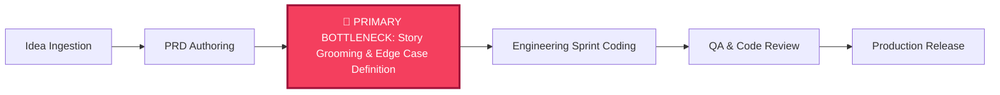

# 🗺️ Product Knowledge Core — Strategy & Constraints (`strategy-and-constraints.md`)

This document outlines strategic positioning, value chain evolution via **Wardley Mapping**, throughput optimization via the **Theory of Constraints (ToC)**, and hard business and market constraints.

---

## 🧭 1. Wardley Map: Value Chain Evolution Table

Wardley Mapping evaluates how components in our system move along the evolution axis:  
`[Genesis (I)] ➔ [Custom-Built (II)] ➔ [Product / Rental (III)] ➔ [Commodity / Utility (IV)]`

| Value Chain Component | Visibility (User ➔ Infra) | Evolution Stage | Evolution Movement | Strategic Play / Rationale |
| :--- | :--- | :--- | :--- | :--- |
| **User Need: High-Velocity Product Delivery** | High (Top) | Need | Fixed | Core anchor of the entire system. |
| **INVEST User Stories & Acceptance Criteria** | High | Product (Stage III) | ➔ Commodity | Moving from bespoke drafting to automated standard generation. |
| **Interactive HTML Prototypes** | High | Product (Stage III) | ➔ Commodity | Tailwind + standard web mockups replace manual design scratchpads. |
| **PM Command Center GUI** | Medium-High | Custom (Stage II) | ➔ Product | Local web interface tailored for PM workflow orchestration. |
| **Context Knowledge Core (`.context/`)** | Medium | Custom (Stage II) | ➔ Product | Differentiator: Single source of truth preventing LLM context contamination. |
| **Tool Synchronization (Jira, Confluence, Miro)** | Medium | Product (Stage III) | ➔ Utility | Powered by Model Context Protocol (MCP) open standard. |
| **Foundational LLMs (Gemini, Claude, GPT)** | Low | Commodity (Stage IV) | Utility | Swappable AI engines treated as computational utilities. |
| **Local Runtime (Python 3, Web Browser)** | Low (Bottom) | Commodity (Stage IV) | Utility | Zero-dependency local host environment; 100% data privacy. |

### Strategic Plays:
1. **Commoditize Upstream Artifacts**: Treat prompt engineering and Gherkin formatting as automated utilities so the PM can focus on high-judgment discovery and customer problem framing.
2. **Moat Around Product Context**: The `.context/` Knowledge Core creates a compounding advantage: the longer a team operates within this structure, the higher the contextual fidelity and lower the hallucination rate.

---

## ⚙️ 2. Theory of Constraints (ToC): Bottleneck Analysis

According to Eliyahu Goldratt's Theory of Constraints, any system's throughput is strictly determined by its single most limiting bottleneck.

### Identification of the Constraint:
- **The Bottleneck**: **Story Grooming & Edge-Case Definition**. Engineers spend 20–40% of sprint time blocked waiting for clarification on missing acceptance criteria, null states, and error handling.
- **Root Cause**: PMs lack the time to manually write exhaustive Gherkin scenarios for every secondary path.

### The 5 Focusing Steps Applied:
1. **Identify the Constraint**: Requirement ambiguity during story grooming halts developer momentum.
2. **Exploit the Constraint**: Ensure every story entered into grooming has an automated **Grooming Readiness Score $\ge 85\%$** using `refine-user-stories`. No developer time should be wasted discussing formatting or standard edge cases.
3. **Subordinate Everything Else to the Constraint**: Upstream skills (`create-prd`, `brainstorm`) must structure data specifically to ease story decomposition; downstream tools (Jira sync) must ingest clean Gherkin directly.
4. **Elevate the Constraint**: Automate boundary value analysis and SPIDR story splitting so an entire epic is decomposed and groomed in minutes.
5. **Prevent Inertia (Repeat)**: Once grooming is automated, the bottleneck will shift downstream to QA verification or upstream to continuous discovery.

---

## 🔒 3. Business & Resource Constraints

| Constraint Category | Parameter | Hard Boundary | Mitigation / Operational Rule |
| :--- | :--- | :--- | :--- |
| **Runtime Dependencies** | Language & Packages | Python 3 standard library only for core CLI & server | Zero `pip install` required for core launchers (`scripts/launch-ui.py`, `init-workspace.py`). |
| **Team Capacity** | Engineering Squads | 2 Cross-functional squads (12 engineers total) | Features must be scoped to ship within 1–2 week sprint boundaries. |
| **Budget & Infrastructure** | Cloud Server Costs | $0 additional cloud infrastructure hosting | Harness runs 100% on the local user machine; zero cloud hosting overhead. |
| **Delivery Timeframe** | Milestone Commitments | Sprint cycles strictly fixed to 2 weeks | Stories must not exceed 5 Fibonacci story points; larger items split via SPIDR. |

---

## 🛡️ 4. Market, Security & Regulatory Constraints

### Data Privacy & Zero Cloud Leakage:
- **Local-First Processing**: Sensitive company PRDs, roadmap documents, and credentials (`.env`) MUST remain on the developer's local machine and never be routed to unapproved 3rd-party servers.
- **Model Agnosticism**: Compatible with local LLMs (via Ollama/LocalAI) as well as commercial enterprise LLM endpoints (Gemini Enterprise, Anthropic Bedrock/Vertex).

### Regulatory Compliance Tiers:
- **Enterprise Tier Requirement**: In `enterprise` mode, PRDs and stories must include explicit sections for:
  - **GDPR**: Data subject consent, data retention, right to erasure.
  - **SOC2 Type II**: Audit logging, access control, encryption in transit & rest.
  - **Traceability Matrix**: Every acceptance criteria linked directly to a parent PRD functional requirement ID (`FR-XX`).
