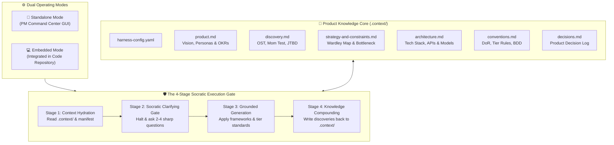
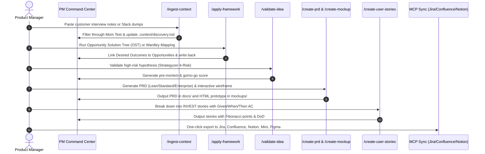

# 📘 AI-Powered Software Development Lifecycle (AI-SDLC) Playbook

> **The Operational Guide for Modern Product Management: From Messy Customer Discovery to Codebase-Grounded Execution.**

---

## 📑 Table of Contents
1. [Executive Summary & Mental Model](#1-executive-summary--mental-model)
2. [Quickstart Onboarding](#2-quickstart-onboarding)
3. [Workflow A: Standalone PM Command Center (Product-Led & Non-Technical PMs)](#3-workflow-a-standalone-pm-command-center)
4. [Workflow B: Embedded Codebase Harness (Technical PMs & Full-Stack Leads)](#4-workflow-b-embedded-codebase-harness)
5. [How to Add a New Framework in 2 Minutes](#5-how-to-add-a-new-framework-in-2-minutes)
6. [Context Hygiene & Long-Term Memory Governance](#6-context-hygiene--long-term-memory-governance)
7. [Cross-Tool Operations Matrix](#7-cross-tool-operations-matrix)

---

## 1. Executive Summary & Mental Model

Traditional product management tools suffer from two crippling failure modes:
1. **The Feature Factory Anti-Pattern**: Brainstorms and PRDs disconnected from business bottlenecks, strategic evolution, and verified customer struggle.
2. **Context Contamination & Hallucination**: AI assistants inventing imaginary APIs, ignoring real architectural constraints, or confusing internal UI instructions with user product requirements.

**AI PM Sidekick** solves this by establishing a **dual-mode operational harness** powered by a persistent, version-controlled **Product Knowledge Core (`.context/`)** and an extensible **Modular Framework Engine (`frameworks/`)**.



### The 4-Stage Socratic Execution Gate
Every generative skill in this harness strictly follows a non-negotiable 4-stage protocol:
1. **Context Hydration**: The agent reads `.context/harness-config.yaml`, `.context/product.md`, `.context/conventions.md`, and active domain files. It never drafts in a vacuum.
2. **Socratic Clarifying Gate**: If critical inputs are missing, vague, or contradictory, the agent **pauses** and asks 2 to 4 concrete clarifying questions. Users who want immediate speed can say *"proceed with assumptions"*, which explicitly documents those working assumptions.
3. **Grounded Generation**: Output is drafted to the requested tier (`lean`, `standard`, or `enterprise`) and filtered through the chosen lens in `frameworks/`.
4. **Knowledge Compounding (Write-Back)**: Once validated, newly discovered user truths, architectural facts, or strategic trade-offs are written back to `.context/` and appended to `.context/decisions.md`.

---

## 2. Quickstart Onboarding

Get up and running in under 2 minutes in either Standalone or Embedded mode.

### Step 1: Initialize the Workspace Harness
Run the zero-dependency Python initialization script:

```bash
# Option A: Standalone PM Command Center with browser GUI:
python3 scripts/init-workspace.py --mode standalone --open

# Option B: Standalone workspace without launching web server:
python3 scripts/init-workspace.py --mode standalone --no-gui

# Option C: Embedded in an existing codebase (auto-scans package.json, pyproject.toml, etc.):
python3 scripts/init-workspace.py --mode embedded --tier standard
```

### Step 2: Configure External MCP Integrations
Connect your tool ecosystem (Atlassian Jira/Confluence, GitHub Issues, Figma, Miro, Notion):

```bash
# Launch interactive terminal setup wizard:
python3 scripts/setup-mcp.py --interactive

# Check connection readiness and credentials:
python3 scripts/setup-mcp.py --check

# Export configs across all AI environments (.agents, .claude, .cursor, root):
python3 scripts/setup-mcp.py --target all
```

### Step 3: Export Multi-Tool Adapters
Compile skills, frameworks, root routers, and the UI manifest:

```bash
python3 scripts/export-skills.py
```

This single command automatically compiles:
- **Google Antigravity / AGY**: Native skills in `.agents/skills/` and `.agents/project-harness/SKILL.md`.
- **Cursor IDE**: System rules in `.cursor/rules/*.mdc` and global instructions in `.cursorrules`.
- **Claude Code**: Slash commands in `.claude/commands/*.md` and workspace instructions in `CLAUDE.md`.
- **Universal Prompt Bundle**: `dist/pm_sidekick_system_prompt.md` for ChatGPT or Claude Projects.
- **GUI Manifest**: `dist/harness-manifest.json` for live dynamic sidepanel navigation.

---

## 3. Workflow A: Standalone PM Command Center

**Ideal for**: Product-led PMs, Group PMs, Founders, and Strategy Leads operating independently of immediate repository code.



### Step-by-Step Walkthrough

#### 1. Ingest Raw Discovery Notes (`/ingest-context`)
Paste raw customer interview transcripts, win/loss sales debriefs, or unstructured stakeholder Slack threads.
- **What happens**: The agent applies The Mom Test filter (extracting verifiable past behavior, real spend, and active workarounds while discarding polite hypothetical praise).
- **Result**: Structured outcomes and pain points are routed directly into `.context/discovery.md`, while strategic shifts update `.context/decisions.md`.

#### 2. Strategic & Opportunity Mapping (`/apply-framework`)
Do not jump straight to building features. Frame the problem first:
```bash
/apply-framework
# Target: .context/discovery.md
# Framework: opportunity-solution-tree
```
- **What happens**: The agent builds an OST linking Business Outcomes $\rightarrow$ Customer Opportunities $\rightarrow$ Candidate Solutions $\rightarrow$ Fastest Assumption Tests.
- **Alternative**: Run `wardley-mapping` to evaluate whether components belong in Genesis, Custom, Product, or Utility, enforcing Build-vs-Buy discipline.

#### 3. Hypothesis & Market Risk Validation (`/validate-idea`)
Pressure-test candidate concepts against Strategyzer's 4 Core Risks:
- **Desirability**: Do customers genuinely care?
- **Feasibility**: Can our engineering team deliver it?
- **Viability**: Does the unit economics model scale?
- **Usability**: Can the target persona adopt it without friction?
- **Pre-mortem**: Pinpoints 3 realistic ways this initiative could fail before a single line of code is written.

#### 4. Specification & Clickable Prototyping (`/create-prd` & `/create-mockup`)
Draft the definitive Product Requirements Document:
```bash
/create-prd
# Choose Mode: lean | standard | enterprise
# Feature: Team Workspace Billing Controls
```
- The agent halts at the **Socratic Clarifying Gate** to resolve edge cases (e.g., handling mid-cycle seat additions or invoice defaults).
- Once confirmed, the PRD is generated in `docs/` adhering to the chosen tier.
- Pair immediately with `/create-mockup` to create a self-contained, clickable HTML wireframe with Tailwind CSS in `mockups/`.

#### 5. Engineering Story Breakdown & Refinement (`/create-user-stories` & `/refine-user-stories`)
Transform the approved PRD into backlog-ready sprint stories:
- Formats in INVEST-compliant user stories (`As a... / I want... / So that...`).
- Generates Gherkin BDD Acceptance Criteria (`Given [precondition] / When [action] / Then [observable result]`).
- Assigns Fibonacci story points ($1, 2, 3, 5, 8$) and Definition of Done (DoD).
- Run `/refine-user-stories` to detect ambiguity, apply SPIDR story splitting, and verify the Grooming Readiness Score reaches $\ge 85\%$.

#### 6. Backlog Prioritization (`/apply-framework`)
Prioritize your candidate backlog using mathematical or qualitative models:
- **RICE Scoring**: $\frac{\text{Reach} \times \text{Impact} \times \text{Confidence}}{\text{Effort}}$ with anti-gaming confidence controls.
- **WSJF**: $\frac{\text{Cost of Delay}}{\text{Job Size}}$ for maximum economic flow velocity.
- **Kano Model**: Prune indifferent features while balancing Must-be, Performance, and Delighters.

#### 7. Multi-System Production Sync
Publish with zero manual copy-pasting:
- `/sync-jira`: Create Epics and user stories with Gherkin acceptance criteria in Jira.
- `/sync-confluence`: Publish the PRD to the team Confluence space.
- `/sync-notion`: Sync research notes and PRDs to your company Notion database.
- `/sync-figma`: Push design briefs and WCAG specs directly to Figma design nodes.
- `/sync-miro`: Export brainstorm stickies and OST diagrams to Miro whiteboards.

---

## 4. Workflow B: Embedded Codebase Harness

**Ideal for**: Technical PMs, Staff/Principal Engineers, and Full-Stack Tech Leads operating directly inside a Git repository.

```mermaid
flowchart LR
    REPO[📦 Codebase Repo] -->|Scan Manifests| INIT[init-workspace.py --mode embedded]
    INIT --> ARCH[.context/architecture.md<br/>Live Schemas, Tech Stack & APIs]
    ARCH --> PRD[/create-prd<br/>Feasibility Grounded]
    PRD --> TEST[Edge-Case & DB Feasibility Check]
    TEST --> STORIES[/create-user-stories<br/>Schema-Aligned BDD]
    STORIES --> GH[/sync-github-issues<br/>Push Issues & Milestones]
```

### Step-by-Step Walkthrough

#### 1. Drop and Initialize the Harness
Navigate to your existing software repository:
```bash
cd /path/to/my-application
python3 /path/to/ai-pm-sidekick/scripts/init-workspace.py --mode embedded
```
- **What happens**: The script scans the repo root for manifest files (`package.json`, `pyproject.toml`, `go.mod`, `Cargo.toml`, `pom.xml`, `docker-compose.yml`, `prisma/schema.prisma`).
- It extracts detected frameworks (e.g. Next.js, FastAPI, PostgreSQL), detects directories, and pre-populates `.context/architecture.md`.

#### 2. Live Architectural Grounding
When running `/create-prd` or `/create-documentation`, the agent reads `.context/architecture.md`:
- Technical feasibility is verified *during* drafting: the agent checks whether proposed features fit current data models and API endpoints.
- Avoids drafting PRDs that demand architectural overhauls without explicit flagging.
- Non-functional requirements (rate limits, p99 latency SLAs, database indexing, auth middleware) are automatically embedded.

#### 3. Schema-Aligned User Stories
When breaking down features with `/create-user-stories`:
- Acceptance criteria cite real database fields and API status codes (`Given authenticated user with org_role: admin... When POST /api/v1/workspaces... Then returns 201 Created`).
- Definition of Done incorporates real test suites (e.g., `pytest`, `npm test`, `playwright`, database migrations).

#### 4. Native GitHub Engineering Handoff (`/sync-github-issues`)
Push sprint deliverables directly to your GitHub repository:
- Run `/sync-github-issues` to export refined user stories as GitHub Issues with milestone assignments, difficulty labels (`tier:lean`, `points:5`), and task checklists.
- Bi-directionally pull open issues back into `BACKLOG.md` to run `/apply-framework` prioritization during sprint grooming.

---

## 5. How to Add a New Framework in 2 Minutes

The framework engine is 100% modular and decoupled from skill logic. You can add any strategy, discovery, or prioritization model in under 2 minutes.

### The 5-Part Framework Schema
Create a new Markdown file in the appropriate directory:
- `frameworks/strategy/<framework-name>.md`
- `frameworks/discovery/<framework-name>.md`
- `frameworks/prioritization/<framework-name>.md`

Every framework file must follow this standardized 5-part structure:

```markdown
# 🏷️ [Category] Framework: [Framework Display Name]

## 1. 🧠 Mental Model & Trigger Conditions
### Theoretical Foundation
[Who invented it, core principles, and the key mental model]

### Primary Purpose
[1-2 sentences on what failure mode this framework prevents]

### Trigger Conditions
[Bullet list of when a PM should reach for this framework]

---

## 2. 📥 Required `.context/` Inputs & Socratic Questions
### Mandatory Context Inputs
- [`.context/product.md`](.context/product.md): [Required fields]
- [`.context/strategy-and-constraints.md`](.context/strategy-and-constraints.md): [Required fields]

### Socratic Inquiry
[2-4 sharp, probing questions the agent must ask before running the model]

---

## 3. ⚙️ Step-by-Step Execution & Scoring Rubric
### Step 1: [Initial Step]
### Step 2: [Scoring / Evaluation / Classification]
### Step 3: [Edge Cases & Anti-Gaming Rules]

---

## 4. 📊 Output Format
[Markdown table schema or Mermaid diagram format]

---

## 5. 💾 `.context/` Write-Back Target
[Specify which file in .context/ is updated and the exact markdown section to update]
```

### Deploying the New Framework
Once your file is saved, run:
```bash
python3 scripts/export-skills.py
```
**Done!** The exporter will automatically:
1. Index the new framework in `dist/harness-manifest.json`.
2. Add the framework to `dist/pm_sidekick_system_prompt.md`.
3. Make it immediately available to `/apply-framework` and the web GUI.

---

## 6. Context Hygiene & Long-Term Memory Governance

Large Language Models degrade significantly when bombarded with stale documentation, circular changelogs, and 10,000-line context dumps. AI PM Sidekick implements strict **Context Hygiene Rules**:

```
                       THE CONTEXT CEILING
┌────────────────────────────────────────────────────────┐
│  .context/*.md files: Max 300 lines each (~2,000 tokens)│
│  Keep only verified, persistent truths & conventions   │
└────────────────────────────────────────────────────────┘
                           │
                           ▼
┌────────────────────────────────────────────────────────┐
│  Old PRDs & Specs move to: docs/archive/               │
│  Ephemeral drafts deleted; only decisions persisted    │
└────────────────────────────────────────────────────────┘
```

### The 5 Golden Hygiene Rules

1. **The 300-Line Soft Ceiling**:
   - Every file in `.context/` (`product.md`, `discovery.md`, `strategy-and-constraints.md`, `architecture.md`, `conventions.md`) should remain under **300 lines**.
   - If a file exceeds 300 lines, run `/ingest-context` with the prompt *"Prune and summarize `.context/discovery.md` into active high-priority insights"*.

2. **Zero Context Contamination (Internal UI vs User Product)**:
   - **Internal Sidekick UI Specs (`ui/specs/`) and Views (`ui/views/`)**: Reserved strictly for the Sidekick's own frontend screens. Never reference them when drafting user product PRDs.
   - **User Product Artifacts (`docs/` and `mockups/`)**: All product manager deliverables belong exclusively in `docs/` (PRDs, specs, stories) and `mockups/` (wireframes, prototypes).

3. **Append-Only Decision Log (`.context/decisions.md`)**:
   - Never rewrite historical product decisions.
   - Record decisions with ADR/PDR metadata: `Date | Decision | Rationale | Alternatives Rejected | Impacted OKRs`.

4. **Archiving Superseded Specs**:
   - When a feature is shipped and verified in production, move its PRD from `docs/` to `docs/archive/YYYY-QX-feature-name.md`.
   - Distill the final data schema into `.context/architecture.md` and retire the temporary specification from the active context.

5. **Anti-Hallucination Triangulation**:
   - If a proposed feature contradicts a constraint in `.context/strategy-and-constraints.md` or `.context/conventions.md`, the agent is instructed to **raise a blocker**, not quietly generate fantasy specs.

---

## 7. Cross-Tool Operations Matrix

| Command / Tool | Category | Input Sources | Primary Output Target | Write-Back Destination |
| :--- | :--- | :--- | :--- | :--- |
| `/gui-run` | GUI | `.env`, `dist/harness-manifest.json` | Web GUI (`localhost:3000`) | User preferences in `.env` |
| `/ingest-context` | Knowledge | Raw notes, transcripts, Slack dumps | Structured summary | `.context/*.md`, `.context/decisions.md` |
| `/apply-framework` | Knowledge | `frameworks/`, `.context/`, ideas, PRDs | Strategy / Priority Matrix | `.context/discovery.md`, `strategy-and-constraints.md` |
| `/validate-idea` | Ideation | Raw concepts, hypotheses | 4-Risk Validation Brief | `docs/`, `.context/discovery.md` |
| `/brainstorm` | Ideation | Problem statement, `.context/product.md` | SCAMPER / HMW Ideas | `docs/`, Miro sticky notes |
| `/create-prd` | Specification | Features, user inputs, `.context/` | Complete PRD (`docs/`) | `.context/decisions.md` |
| `/create-mockup` | Specification | PRD, UI requirements | Clickable HTML Wireframe (`mockups/`) | Component notes in `docs/` |
| `/create-design-brief`| Specification | PRD, wireframe, user flows | UI/UX Brief (`docs/`) | Design tokens in `.context/conventions.md` |
| `/create-user-stories`| Specification | PRD, feature specs | INVEST Stories (`docs/`) | Backlog tickets in Jira / GitHub |
| `/refine-user-stories`| Specification | User stories, backlog | SPIDR-Split Stories (`docs/`) | Grooming Score in `docs/` |
| `/create-documentation`| Specification| PRD, tech stack, architecture | OpenAPI & User Manual (`docs/`) | Updates to `.context/architecture.md` |
| `/connect-mcp` | Sync | API tokens in `.env` | Active MCP Server Connections | `mcp.json`, `.agents/`, `.cursor/`, `.claude/` |
| `/sync-jira` | Sync | Stories in `docs/` or `BACKLOG.md` | Jira Epics & Issues | Synced Issue Keys in `BACKLOG.md` |
| `/sync-confluence` | Sync | PRD in `docs/` | Confluence Space Pages | Page URL in PRD metadata |
| `/sync-github-issues`| Sync | Stories, `BACKLOG.md` | GitHub Issues & Milestones | Issue # links in `BACKLOG.md` |
| `/sync-figma` | Sync | Design brief in `docs/` | Figma Comments & Inspect Specs | Node IDs in Design Brief |
| `/sync-miro` | Sync | Brainstorm notes, OST | Miro Board & Sticky Notes | Miro Board URL in `docs/` |
| `/sync-notion` | Sync | PRD, notes, database | Notion Pages & Databases | Notion Page URL in `docs/` |

---

*AI PM Sidekick — Built with ❤️ for Product Managers who demand strategic rigor, architectural grounding, and zero busywork.*
