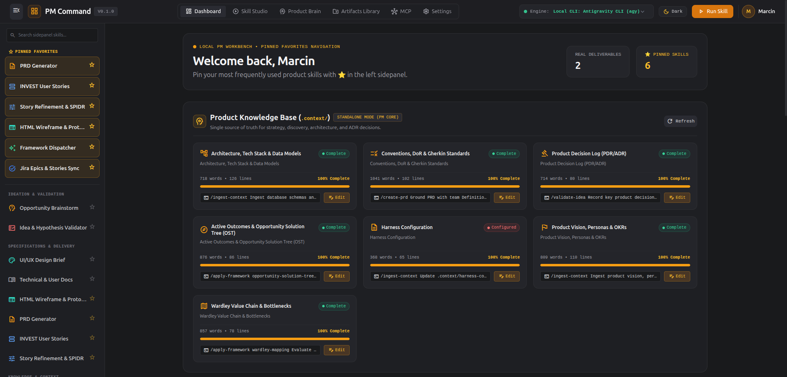
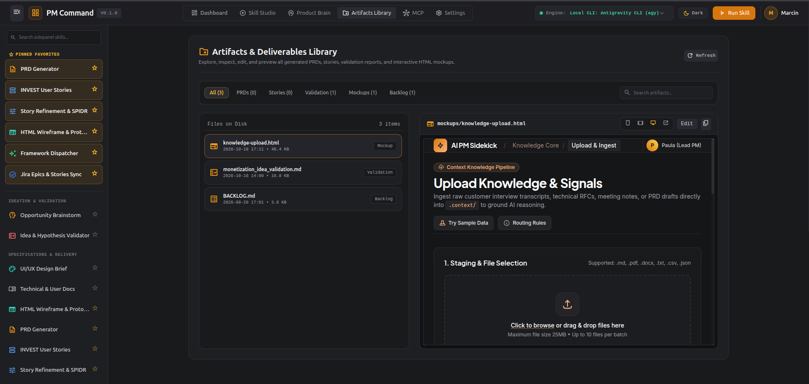
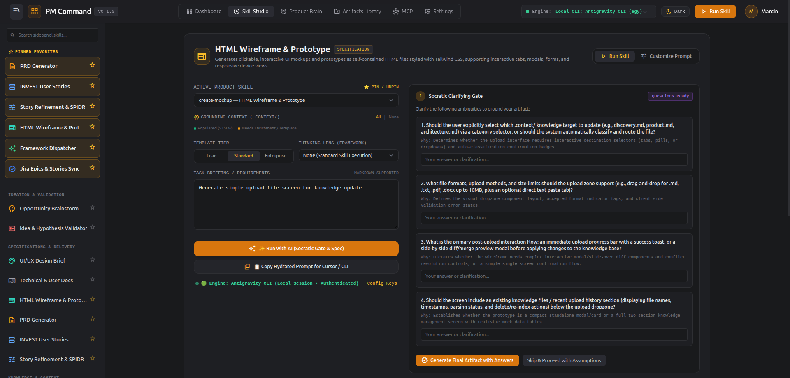
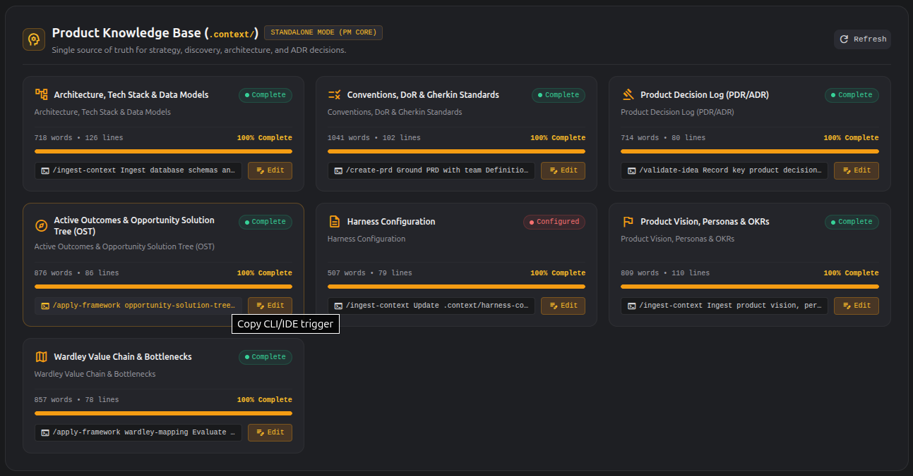

# 🚀 AI PM Sidekick

**AI PM Sidekick** is a local-first, privacy-respecting, tool-agnostic AI assistant framework and harness built for Product Managers, Technical PMs, and Engineering Leads. It bridges the gap between chaotic customer discovery and engineering execution—powering idea validation, PRDs, user stories, interactive HTML wireframes, design briefs, technical documentation, the **PM Command Center Web GUI**, and **live bi-directional MCP integrations with Atlassian (Jira & Confluence), GitHub Issues, Figma, Miro, Notion, and Google Stitch**.

> 📖 **Looking for the complete operational guide?**  
> Read the [📘 AI-SDLC Playbook (AI_SDLC.md)](AI_SDLC.md) for step-by-step walkthroughs of **Workflow A (Standalone PM Command Center)**, **Workflow B (Embedded Codebase Harness)**, adding custom frameworks in 2 minutes, and context hygiene rules.

<p align="center">
  
</p>

---

## 🌟 Core Capabilities & 27 Canonical Skills (+ 2 Isolated Sub-Agents)

| Skill / Integration | Slash Command | Category | Description | Primary Output Target | Next Skill Suggestion |
| :--- | :--- | :--- | :--- | :--- | :--- |
| **PM Command Center** | `/gui-run` | `gui` | SaaS web studio, Product Brain manager, Artifact library, & REST server on `localhost:3000` | Local Web Browser | `create-prd`, `connect-mcp` |
| **Context Ingestion** | `/ingest-context` | `knowledge` | Distills raw notes, calls, & Slack dumps into `.context/` & `.context/.inbox/` | `.context/discovery.md`, `.context/.inbox/` | `apply-framework`, `create-prd` |
| **Compact Context** | `/compact-context` | `knowledge` | Merges reviewed `.context/.inbox/` patches & compacts bloated `.context/*.md` files | `.context/*.md` | `create-prd`, `apply-framework` |
| **Apply Framework** | `/apply-framework` | `knowledge` | Runs strategic, discovery, prioritization, & operational models | `.context/`, `BACKLOG.md`, `docs/` | `create-prd`, `create-user-stories` |
| **Recommend Framework** | `/recommend-framework` | `knowledge` | Diagnoses bottlenecks & uncertainty, recommends the optimal framework & skill with anti-pattern warnings | Diagnostic recommendation in chat | `apply-framework`, `create-prd` |
| **Idea Validation** | `/validate-idea` | `ideation` | Evaluates raw concepts & hypotheses (4-Risk, Mom Test, Pre-mortem) | 4-Risk Brief in `docs/` | `brainstorm`, `create-prd` |
| **Brainstorming** | `/brainstorm` | `ideation` | Generates innovative solution angles (SCAMPER, HMW, 6 Hats) | Opportunity doc in `docs/` | `sync-docs-design`, `create-prd` |
| **PRD Generation** | `/create-prd` | `specification` | Generates structured PRDs across Lean, Standard, and Enterprise tiers | PRD in `docs/` | `create-mockup`, `create-user-stories` |
| **Clickable Mockups** | `/create-mockup` | `specification` | Generates self-contained, interactive Tailwind HTML wireframes | HTML prototype in `mockups/` | `create-design-brief`, `create-user-stories` |
| **Design Briefs** | `/create-design-brief` | `specification` | Bridges PM and UI/UX design specs with WCAG 2.1 AA accessibility | UI/UX Brief in `docs/` | `sync-docs-design`, `create-mockup` |
| **User Stories** | `/create-user-stories` | `specification` | Breaks down features into INVEST stories + Gherkin BDD AC | User Stories in `docs/` | `refine-user-stories`, `sync-backlog` |
| **Story Grooming** | `/refine-user-stories` | `specification` | Refines & splits stories using SPIDR with Readiness Score | Refined Stories in `docs/` | `sync-backlog`, `sync-linear` |
| **Documentation** | `/create-documentation` | `specification` | Dual tech spec & user guide generator (OpenAPI 3.0, Mermaid) | Tech Docs & Manuals in `docs/` | `sync-docs-design` |
| **Stakeholder Update** | `/create-stakeholder-update` | `communication` | Synthesizes git & backlog into Executive digests, team updates, or release notes | Status update in `docs/updates/` | `sync-docs-design`, `refine-user-stories` |
| **User Interview Guide**| `/prepare-user-interview` | `discovery` | Non-leading Mom Test guides, screener questions, & assumption probes | Interview guide in `docs/research/` | `ingest-context`, `apply-framework` |
| **Metrics & Experiments**| `/define-metrics-and-experiment` | `specification` | Defines North Star hierarchies, event telemetry schemas, & A/B rollout gates | Metrics spec in `docs/specs/` | `create-prd`, `create-user-stories` |
| **Spec Auditor** | `/audit-spec` | `specification` | VP Product + Staff Eng review auditing scope creep, edge cases, & architecture | Audit report in `docs/reviews/` | `refine-user-stories`, `plan-launch` |
| **GTM Launch Plan** | `/plan-launch` | `operations` | Tier 1/2/3 launch playbook with positioning copy, enablement FAQ, & kill switches | Launch plan in `docs/gtm/` | `create-stakeholder-update`, `evaluate-launch` |
| **Outcome Roadmap** | `/create-roadmap` | `strategy` | Transforms backlog into Now/Next/Later or Quarterly OKR outcome horizons | Roadmap doc in `docs/roadmap/` | `prep-meeting`, `create-user-stories` |
| **Meeting Defense Brief**| `/prep-meeting` | `communication` | 1-page defense brief with decision history, hostile questions, & trade-off boxes | Brief in `docs/meetings/` | `create-stakeholder-update` |
| **Competitor Battlecard**| `/analyze-competitor` | `strategy` | Feature parity matrix, positioning teardowns, & Sales/PM battlecards | Battlecard in `docs/competitive/` | `plan-launch`, `create-prd` |
| **Linear Sync** | `/sync-linear` | `sync` | Bi-directional Linear cycles, projects, issues, and triage inbox sync via MCP | Linear Issues & Projects | `refine-user-stories`, `triage-feedback` |
| **Feedback Triage** | `/triage-feedback` | `discovery` | Clusters raw support/NPS/transcript feedback by frequency & severity | Triage ledger in `docs/discovery/`| `create-prd`, `prepare-user-interview` |
| **Launch Retrospective**| `/evaluate-launch` | `operations` | Evaluates telemetry against PRD targets and logs lessons to decisions.md | Retro doc in `docs/retrospectives/` | `create-stakeholder-update`, `refine-user-stories` |
| **MCP Manager** | `/connect-mcp` | `sync` | Connects & verifies external PM tools across IDEs | `mcp.json` & `.env` | `sync-backlog`, `sync-docs-design` |
| **Delivery Backlog Sync** | `/sync-backlog` | `sync` | Bi-directional Epic & INVEST User Story sync with **Jira** and **GitHub Issues** via MCP | Jira & GitHub Issues | `sync-docs-design`, `refine-user-stories` |
| **Docs & Design Sync** | `/sync-docs-design` | `sync` | Synchronizes PRDs, design briefs, & OST maps with **Confluence, Notion, Figma, & Miro** via MCP | Confluence, Notion, Figma, Miro | `sync-backlog`, `create-mockup` |

### 🤖 Isolated Sub-Agents (`agents/`)
- **`pm-critic`** ([`agents/pm-critic.md`](agents/pm-critic.md)): Isolated, read-only adversarial PM reviewer that audits PRDs, user stories, and strategy docs against `.context/` constraints, hunting for unvalidated assumptions, feature-factory output, and scope creep without polluting the main drafting window.
- **`discovery-synthesizer`** ([`agents/discovery-synthesizer.md`](agents/discovery-synthesizer.md)): Forked-context transcript miner that ingests raw user interview transcripts (> 2,000 words), support tickets, or competitor notes and distills Mom Test / JTBD insights into `.context/.inbox/` while returning only a summary (< 250 words) to the parent session.

---

## 🖥️ PM Command Center Web GUI

Launch with `python3 scripts/launch-ui.py --open` (or `/gui-run`) for a visual PM studio:

<div align="center">
  <table>
    <tr>
      <td width="50%">
        
        <p align="center"><b>Deliverables Hub & Responsive Sandbox</b><br/><i>Preview PRDs, user stories, and interactive device prototypes (Desktop/Tablet/Mobile)</i></p>
      </td>
      <td width="50%">
        
        <p align="center"><b>Interactive Skill Studio</b><br/><i>Form-based wizard with framework lenses & Socratic clarifying gate</i></p>
      </td>
    </tr>
    <tr>
      <td width="50%">
        
        <p align="center"><b>Product Brain & Health Scores</b><br/><i>Live completeness tracking for <code>.context/</code> single source of truth</i></p>
      </td>
      <td width="50%">
        
        <p align="center"><b>Atelier Command Center</b><br/><i>SaaS-style dark & light workbench with local engine detection</i></p>
      </td>
    </tr>
  </table>
</div>


- **Zero-Config Local CLI Auto-Detection**: Automatically detects local authenticated AI CLIs (`agy`, `gemini`, `claude`, `cursor`) on your `PATH`. Execute prompts and skills directly in the browser—**no API keys in `.env` required**.
- **Live IDE Companion Mode**: 4-second background file-system polling synchronizes newly generated PRDs, stories, and context files created from external terminal or Cursor IDE chat sessions without requiring a browser reload.
- **Product Brain Manager**: Live health cards for all 6 `.context/` files with line/word counts, quick-append modal, and inline markdown editor/previewer.
- **Deliverables & Artifacts Hub**: Dual-pane workspace with search, category filtering (PRDs, Stories, Validation, Mockups, Backlog), live markdown preview, in-place editor, and an interactive responsive sandbox iframe (Desktop, Tablet, Mobile) for HTML prototypes.
- **Functional Dark & Light Theme**: Toggle seamlessly between dark atelier and clean, high-contrast light SaaS modes with zero-flash persistence backed by `localStorage`.

---

## 🧠 The `.context/` Product Knowledge Core

At the center of AI PM Sidekick is a persistent, version-controlled **single source of truth** in `.context/`. Instead of stuffing massive prompts into ephemeral chat windows, agents continuously hydrate from and compound knowledge back into these structured files:

- [`.context/harness-config.yaml`](.context/harness-config.yaml): Workspace mode (`standalone` vs `embedded`), default tier (`lean`, `standard`, `enterprise`), operating model (`scrum`, `shape-up`, `kanban`, `gist`), active frameworks across all 4 categories, favorite skills, and enabled MCP integrations.
- [`.context/product.md`](.context/product.md): High-level strategic vision, primary personas, core value loops, North Star metric, and quarterly OKRs.
- [`.context/discovery.md`](.context/discovery.md): Teresa Torres Opportunity Solution Trees (OST), active customer opportunities, and verified Mom Test insights.
- [`.context/strategy-and-constraints.md`](.context/strategy-and-constraints.md): Wardley Map value chain evolution table, Theory of Constraints system bottleneck, and business/regulatory constraints.
- [`.context/architecture.md`](.context/architecture.md): Live tech stack, entity data models, API boundaries, security constraints, and codebase directory layout.
- [`.context/conventions.md`](.context/conventions.md): Team Definition of Ready (DoR), Given/When/Then Gherkin acceptance criteria standards, and tier rules.
- [`.context/decisions.md`](.context/decisions.md): Append-only immutable Product Decision Log (PDR/ADR) tracking historical trade-offs, rationale, and rejected alternatives.
- [`.context/.inbox/`](.context/.inbox/README.md): Human-gated staging inbox for proposed updates to protected files (`product.md`, `strategy-and-constraints.md`, `decisions.md`). Merge and compact via `/compact-context`.

### 🛡️ Mechanical Context Gate (`scripts/verify-context-gate.py`)
Definition skills (`create-prd`, `create-user-stories`, `create-design-brief`) enforce a deterministic two-phase mechanical gate:
- **Pre-Flight Check (`--mode pre-skill`)**: Verifies required `.context/` files exist, are populated past template placeholders, and stay within the 300-line soft ceiling.
- **Verify-on-Stop Guard (`--mode verify-stop`)**: Blocks artifact completion if unresolved `[TBD]` or `TODO:` markers remain or required structural sections are missing.

### 🚫 Strict Asset Separation (Zero Context Contamination)
To eliminate AI hallucinations:
- **Internal Sidekick UI Specs & Views (`ui/specs/`, `ui/views/`)**: Reserved strictly for the Sidekick's own web UI.
- **User Product Deliverables (`docs/`, `mockups/`)**: All PRDs, user stories, and specs belong exclusively in `docs/`; all wireframes belong in `mockups/`.

---

## 🗺️ Modular Framework Engine (23 Frameworks)

AI PM Sidekick includes a decoupled library of 23 industry-standard strategic, discovery, prioritization, and operational frameworks:

### 1. Strategic Frameworks ([`frameworks/strategy/`](frameworks/strategy/))
- **`wardley-mapping`**: Plots value chain components along Visibility vs. Evolution (Genesis ➔ Custom ➔ Product ➔ Commodity) to enforce disciplined Build-vs-Buy decisions.
- **`theory-of-constraints`**: Executes Goldratt's 5 Focusing Steps to exploit the primary system bottleneck choking sprint throughput, backed by Current Reality Trees (CRT).
- **`working-backwards-prfaq`**: Amazon-style Press Release, Customer FAQ, and Internal Stakeholder FAQ to clarify customer value before writing code.
- **`north-star-metric-tree`**: Decomposes lagging company revenue into a single customer-value North Star Metric and 4 actionable Input Metric levers (Breadth, Depth, Frequency, Efficiency).
- **`product-positioning`**: April Dunford 5-component positioning engine (Alternatives ➔ Attributes ➔ Value ➔ Target ➔ Category) for differentiated GTM.
- **`seven-powers-moats`**: Hamilton Helmer structural defensibility audit evaluating Scale, Network Economies, Counter-Positioning, Switching Costs, Branding, Cornered Resources, and Process Power.
- **`pricing-and-packaging`**: Van Westendorp 4 price sensitivity thresholds and Good-Better-Best feature tiering matrix (Leaders, Fillers, Killers).

### 2. Discovery Frameworks ([`frameworks/discovery/`](frameworks/discovery/))
- **`opportunity-solution-tree`**: Teresa Torres OST framework connecting Desired Business Outcomes $\rightarrow$ Customer Opportunities (unmet needs) $\rightarrow$ Candidate Solutions $\rightarrow$ Fastest Assumption Tests.
- **`jtbd-and-mom-test`**: Maps Functional, Emotional, and Social jobs across the Four Forces of Progress ($\text{Push} + \text{Pull} > \text{Anxiety} + \text{Habit}$) and filters customer interviews for behavioral facts over empty compliments.
- **`assumption-mapping`**: Categorizes assumptions across Desirability, Feasibility, Viability, and Usability; plots on Importance vs Evidence 2x2 to design Riskiest Assumption Tests (RATs).
- **`aarrr-and-growth-loops`**: Diagnoses funnel drop-offs across Acquisition, Activation, Retention, Referral, and Revenue; models self-reinforcing viral, content, and paid growth loops.

### 3. Prioritization Frameworks ([`frameworks/prioritization/`](frameworks/prioritization/))
- **`rice`**: Quantitative score ($\frac{\text{Reach} \times \text{Impact} \times \text{Confidence}}{\text{Effort}}$) featuring strict anti-gaming confidence thresholds ($100\%, 80\%, 50\%, 20\%$).
- **`wsjf-cost-of-delay`**: Weighted Shortest Job First economic scheduling ($\frac{\text{User Value} + \text{Time Criticality} + \text{Risk Reduction}}{\text{Job Size}}$).
- **`kano-model`**: Non-linear customer satisfaction classification (Must-be, One-dimensional, Attractive, Indifferent) using functional/dysfunctional question pairs.
- **`ice-and-value-effort`**: Fast, lightweight prioritization ($Impact \times Confidence \times Ease$) + 2x2 Value vs Effort matrix for 0-to-1 speed without RICE false precision.
- **`opportunity-scoring`**: Dan Olsen / Anthony Ulwick formula ($Importance + \max(Importance - Satisfaction, 0)$) identifying underserved customer jobs vs over-served table stakes.
- **`moscow-scope-negotiation`**: Must Have ($\le 60\%$), Should Have ($\sim 20\%$), Could Have ($\sim 20\%$), and Won't Have scope boundaries with Buy-a-Feature budget games.

### 4. Operational & Delivery Frameworks ([`frameworks/operations/`](frameworks/operations/))
- **`scrum-sprint-delivery`**: Sprint Goal definition, backlog grooming, velocity slicing, INVEST user story breakdown, and sprint retrospective cadence.
- **`shape-up`**: Basecamp's fixed-time/variable-scope methodology with 6-week cycles, appetites, pitch shaping, rabbit holes, and Hill Charts.
- **`gist-planning`**: Itamar Gilad's agile roadmapping connecting strategic Goals $\rightarrow$ prioritized Ideas $\rightarrow$ validated Step-projects $\rightarrow$ tactical Tasks.
- **`user-story-mapping`**: Jeff Patton two-dimensional narrative backbone (Activities ➔ Steps) with vertical Walking Skeleton (MVP) and release slices.
- **`pre-mortem-tigers`**: Shreyas Doshi risk simulation separating real catastrophic threats (Tigers), vocal harmless noise (Paper Tigers), and unspoken team taboos (Elephants).
- **`kanban-continuous-flow`**: Continuous pull delivery governed by Little's Law with column WIP limits, Service Level Expectations (SLE), and Classes of Service.

### 🧭 Diagnostic Frontmatter & Framework Dispatcher (`/recommend-framework`)
Every framework implements a standardized YAML frontmatter schema (`problem_signatures`, `best_for_stage`, `data_maturity_required`, `when_not_to_use`, `paired_skills`, `write_back_target`).
- Run `/recommend-framework` to diagnose your team's specific uncertainty or bottleneck. The agent recommends the optimal primary framework, provides a lightweight alternative, and highlights common anti-patterns.
- Validate framework conformity anytime by running `python3 scripts/export-skills.py`, which includes a diagnostic schema linter.

> 💡 **Add your own custom framework in under 2 minutes!** Follow the standardized 5-part schema in [`frameworks/README.md`](frameworks/README.md) and place your spec in `frameworks/strategy/`, `frameworks/discovery/`, `frameworks/prioritization/`, or `frameworks/operations/`.

---

## 🔌 7 Live MCP Tool Integrations

Connect the Sidekick directly to your team's production tool stack using the Model Context Protocol (MCP):

| Tool | Supported Workflows | MCP Server Package |
| :--- | :--- | :--- |
| **Atlassian (Jira)** | Backlog sync, epic generation, ticket creation, status updates | `npx -y @atlassian/mcp` |
| **Atlassian (Confluence)**| PRD publishing, engineering spec updates, space page creation | `npx -y @atlassian/mcp` |
| **Linear** | Cycle tracking, project sync, INVEST story creation, triage queues | `npx -y mcp-server-linear` |
| **GitHub Issues** | Bi-directional issue sync, milestone mapping, label assignment | `npx -y @modelcontextprotocol/server-github` |
| **Figma** | Design file inspection, component discovery, canvas comments | `npx -y @figma/mcp` |
| **Miro** | Sticky note brainstorming, OST visual maps, roadmap exports | `npx -y @miro/mcp` |
| **Notion** | Research database syncing, product wiki publishing, PDR logs | `npx -y @notionhq/notion-mcp-server` |

---

## 🚀 Quick Start Guide

### 1. Initialize Workspace
```bash
# Standalone mode (launches local web GUI & PM Command Center):
python3 scripts/init-workspace.py --mode standalone --open

# Embedded mode (scans existing codebase & pre-populates .context/architecture.md):
python3 scripts/init-workspace.py --mode embedded --tier standard
```

### 2. Configure MCP Credentials
```bash
# Run interactive setup wizard for Jira, Confluence, GitHub, Figma, Miro, Notion:
python3 scripts/setup-mcp.py --interactive

# Audit readiness and verify credentials:
python3 scripts/setup-mcp.py --check
```

### 3. Compile Skills & Multi-Tool Adapters
```bash
python3 scripts/export-skills.py
```
This generates native configurations for:
- **AGY / Gemini**: `.agents/skills/`, `.agents/agents/`, `.gemini/agents/`, and `AGENTS.md`
- **Cursor IDE**: `.cursor/rules/*.mdc` and `.cursorrules`
- **Claude Code**: `.claude/commands/*.md`, `.claude/agents/`, `.claude/settings.json`, and `CLAUDE.md`
- **Mistral Vibe**: `.vibe/hooks.toml`
- **ChatGPT / Custom GPTs**: `dist/pm_sidekick_system_prompt.md` (with `<!-- SYSTEM_PROMPT_DYNAMIC_BOUNDARY -->` cache tiering)
- **Web GUI Sidepanel**: `dist/harness-manifest.json` (27 skills, 23 frameworks, 7 context files, 2 isolated sub-agents)

---

## 🎯 3 Operational Deliverable Tiers

When generating PRDs or User Stories, choose your compliance and detail tier:
1. **⚡ Lean Mode (Startup / MVP)**: 1-page PRDs, rapid bullet acceptance criteria, minimal overhead.
2. **🎯 Standard Agile Mode (Default / Growth)**: Full INVEST criteria, Gherkin BDD (`Given/When/Then`), Fibonacci story points, and Definition of Done.
3. **🏢 Enterprise Mode (Compliance / Scale)**: Traceability matrices, SOC2/GDPR compliance tags, security assertions, SLA targets, and audit log specifications.

Configure your preferred default tier and operating model (`scrum`, `shape-up`, `kanban`, `gist`) in [`.context/harness-config.yaml`](.context/harness-config.yaml).

---

## 📚 Complete Documentation & Playbook

- **Operational Playbook**: [📘 AI-SDLC Playbook (AI_SDLC.md)](AI_SDLC.md)
- **Framework Guide**: [🗺️ Frameworks Architecture (frameworks/README.md)](frameworks/README.md)
- **MCP Connection Guide**: [🔌 MCP Connect Guide (skills/connect-mcp/SKILL.md)](skills/connect-mcp/SKILL.md)
- **Backlog**: [📋 Product Backlog (BACKLOG.md)](BACKLOG.md)

---

*AI PM Sidekick — Built with ❤️ for Product Managers who demand strategic rigor, architectural grounding, and zero busywork.*
