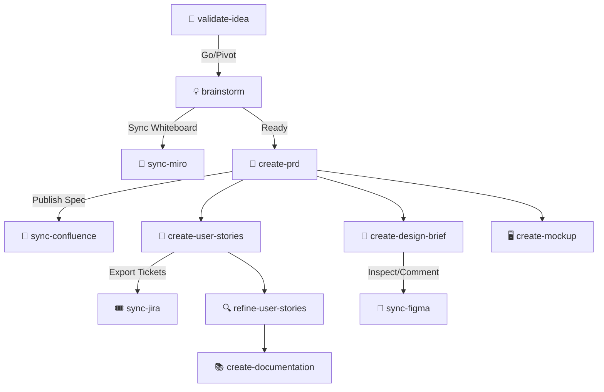

# 🚀 AI PM Sidekick

**AI PM Sidekick** is a tool-agnostic AI assistant framework built to empower Product Managers across the entire product lifecycle—from idea validation and PRDs to user stories, interactive HTML wireframes, design briefs, technical documentation, **PM Command Center Web GUI**, and **live integrations via MCP with Atlassian (Jira, Confluence), Figma, Miro, and Google Stitch**.

---

## 🌟 Core Capabilities & MCP Integrations

| Skill / Integration | Slash Command | Description | Integration Framework / Standard | Next Skill Suggestion |
| :--- | :--- | :--- | :--- | :--- |
| **PM Command Center** | `/gui-run` | Web GUI dashboard & REST API on `localhost:3000` | Google Stitch Atelier UI, REST API, Localhost daemon | `create-prd`, `connect-mcp` |
| **Idea Validation** | `/validate-idea` | Evaluates raw concepts & hypotheses | Strategyzer 4-Risk, The Mom Test, TAM/SAM/SOM, Pre-mortem | `brainstorm` or `create-prd` |
| **Brainstorming** | `/brainstorm` | Generates innovative solution angles | SCAMPER, How Might We (HMW), 6 Hats, Value vs Effort | `sync-miro`, `create-prd` |
| **PRD Generation** | `/create-prd` | Generates structured PRDs | 3 Modes (Lean, Standard Agile, Enterprise) | `sync-confluence`, `create-user-stories` |
| **Clickable Mockups** | `/create-mockup` | Generates interactive HTML wireframes | Tailwind CSS, interactive modals/tabs | `create-design-brief`, `create-user-stories` |
| **Design Briefs** | `/create-design-brief` | Bridges PM and UI/UX design specs | WCAG 2.1 AA accessibility, UX flows, Figma handoff | `sync-figma`, `create-mockup` |
| **User Stories** | `/create-user-stories` | Creates engineering-ready user stories | INVEST, Gherkin BDD (`Given/When/Then`), Fibonacci Points, DoD | `sync-jira`, `refine-user-stories` |
| **Story Grooming** | `/refine-user-stories` | Refines & splits stories with Readiness Score | SPIDR Splitting framework, Grooming Score (0-100%) | `sync-jira`, `create-documentation` |
| **Documentation** | `/create-documentation` | Dual tech spec & user guide generator | OpenAPI 3.0, Mermaid sequence diagrams, User manuals | `sync-confluence` |
| **MCP Setup & Connection** | `/connect-mcp` | Connects & verifies external PM tools | Model Context Protocol (MCP), `.env` credentials | `sync-jira`, `sync-confluence`, `sync-figma`, `sync-miro` |
| **Jira Backlog Sync** | `/sync-jira` | Exports stories/epics directly to Jira | Atlassian MCP (`jira_create_issue`, `jira_update_issue`) | `sync-confluence`, `refine-user-stories` |
| **Confluence Doc Sync** | `/sync-confluence` | Publishes PRDs/specs to Confluence | Atlassian MCP (`confluence_create_page`) | `sync-jira` |
| **Figma Design Sync** | `/sync-figma` | Inspects components & posts Figma comments | Figma MCP (`figma_get_file`, `figma_post_comment`) | `create-mockup`, `create-user-stories` |
| **Miro Whiteboard Sync** | `/sync-miro` | Exports sticky notes & matrices to Miro | Miro MCP (`miro_create_board`, `miro_create_sticky_note`) | `validate-idea`, `create-prd` |

---

## 🔌 Connecting External Tools via MCP (Atlassian, Figma, Miro)

You can easily configure and activate live MCP connections to your favorite external tools using the included setup CLI script or slash commands:

### 1. Interactive Setup CLI
Run the MCP connection wizard in your terminal:
```bash
# Interactive setup wizard to configure Atlassian (Jira/Confluence), Figma, and Miro:
python3 scripts/setup-mcp.py --interactive

# Or generate MCP config across all platforms (AGY, Claude Code, Cursor):
python3 scripts/setup-mcp.py --target all

# Verify connection readiness & credentials:
python3 scripts/setup-mcp.py --check
```

### 2. Required Credentials (`.env`)
Fill in your credentials in `.env` (or let the interactive wizard populate it):
```env
# Atlassian (Jira & Confluence)
ATLASSIAN_HOST=https://your-company.atlassian.net
ATLASSIAN_EMAIL=pm@company.com
ATLASSIAN_API_TOKEN=your_atlassian_api_token

# Figma
FIGMA_ACCESS_TOKEN=your_figma_personal_access_token

# Miro
MIRO_ACCESS_TOKEN=your_miro_access_token
```

### 3. Native Configuration Files Auto-Generated
- **AGY / Antigravity**: `.agents/mcp.json`
- **Claude Code**: `.claude/mcp.json`
- **Cursor IDE**: `.cursor/mcp.json`

---

## ⚡ Slash Command Invocation & Tool Usage

You can invoke any skill using **slash commands** (`/command`) or natural language, depending on your AI tool environment:

### 1. Claude Code / Claude CLI (`/command` Native)
In Claude Code, exported commands in `.claude/commands/` are registered natively as slash commands:
- `/connect-mcp`
- `/sync-jira`
- `/sync-confluence`
- `/sync-figma`
- `/sync-miro`
- `/validate-idea`
- `/brainstorm`
- `/create-prd`
- `/create-user-stories`
- `/refine-user-stories`
- `/create-mockup`
- `/create-design-brief`
- `/create-documentation`

### 2. Antigravity / AGY / Gemini (`/command` & Progressive Skill Activation)
In AGY, skills stored in `.agents/skills/<skill>/SKILL.md` can be called by typing:
- `/connect-mcp` or *"Connect external tools via MCP..."*
- `/sync-jira` or *"Export user stories to Jira..."*
- `/sync-confluence` or *"Publish PRD to Confluence..."*
- `/sync-figma` or *"Inspect Figma design file..."*
- `/sync-miro` or *"Export brainstorm sticky notes to Miro..."*

### 3. Cursor IDE (`@rule` or `/command` Alias)
In Cursor, skills in `.cursor/rules/*.mdc` are automatically triggered by topic matching, or explicitly invoked via:
- Type `@sync-jira` or `/sync-jira` in chat prompt.

---

## 🔄 End-to-End Workflow Progression & MCP Flow Handling

AI PM Sidekick seamlessly integrates with external tool ecosystems at every phase of the PM pipeline:



---

## ⚙️ Multi-Tool Compatibility

AI PM Sidekick is designed to be **100% tool-agnostic**. Run `python3 scripts/export-skills.py` to deploy to your tool of choice:

* **AGY / Gemini**: Installed natively in `.agents/skills/<skill>/SKILL.md`
* **Cursor IDE**: Exported to `.cursor/rules/<skill>.mdc`
* **Claude Code / Claude Projects**: Exported to `.claude/commands/<skill>.md`
* **ChatGPT / Custom GPTs**: Generated as a single system prompt bundle at `dist/pm_sidekick_system_prompt.md`

---

## 🚀 Quick Start Guide

### 1. Installation & Export
```bash
git clone https://github.org/your-org/ai-pm-sidekick.git
cd ai-pm-sidekick
python3 scripts/export-skills.py
```

### 2. Configure MCP Integrations
```bash
python3 scripts/setup-mcp.py --interactive
```

### 3. Using Capabilities
In **AGY**, **Cursor**, or **Claude**, invoke the skills by slash command or natural language:
* `/connect-mcp` — Set up and verify Atlassian, Figma, and Miro integrations
* `/sync-jira` — Push stories & Gherkin criteria directly to Jira backlog
* `/sync-confluence` — Publish PRDs and tech specs straight to Confluence
* `/sync-figma` — Import design components and post feedback to Figma nodes
* `/sync-miro` — Transform SCAMPER brainstorms into Miro sticky note whiteboards
* `/create-prd` — Generate a standard PRD for user onboarding flow
* `/create-user-stories` — Create user stories in Standard Agile mode

---

## 🎯 3 Operational Modes (PRD & User Stories)

Select your operational context when triggering PRD or User Story generation:
1. **⚡ Lean Mode**: 1-page PRD & concise bullet acceptance criteria (ideal for MVPs & hackathons).
2. **🎯 Standard Agile Mode** *(Default)*: Full INVEST criteria, Gherkin BDD, Fibonacci story points, and DoD.
3. **🏢 Enterprise Mode**: Traceability matrix, SOC2/GDPR compliance tags, security assertions, SLA targets, and audit log specs.

---

## 📋 Extended Backlog
See [BACKLOG.md](./BACKLOG.md) for planned future capabilities including Competitor Analysis, RICE Backlog Prioritization, Customer Interview Synthesizer, Analytics Telemetry Plan, and Release Notes Generator.

