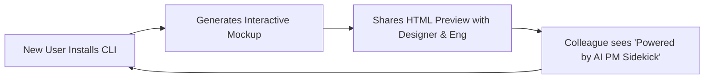

# 🏴‍☠️ Discovery Framework: AARRR Pirate Metrics & Growth Loops

## 1. 🧠 Mental Model & Trigger Conditions

### Theoretical Foundation
Originated by **Dave McClure** (500 Startups) and extended by **Reforge** (Elena Verna, Brian Balfour), this framework combines the linear **AARRR Funnel** with non-linear **Growth Loops**:
1. **The Linear AARRR Funnel**:
   - **Acquisition**: Where and how do users discover the product?
   - **Activation**: Do they experience the core "Aha!" moment in session 1?
   - **Retention**: Do they return regularly over week 1, month 1, and month 3?
   - **Referral**: Do they invite teammates, share artifacts, or advocate to peers?
   - **Revenue**: Do they upgrade to paid plans, seat expansions, or higher tiers?
2. **Compounding Growth Loops**:
   Rather than treating the funnel as a one-way linear leak, high-growth products engineer loops where the output of one cycle feeds directly as the input to the next:
   - *Virality Loop*: User creates artifact ➔ Shares with colleague ➔ Colleague signs up to edit.
   - *Content / SEO Loop*: User creates public spec ➔ Indexed by search ➔ New user finds solution.
   - *Data / Engagement Loop*: User adds repo context ➔ AI answers improve ➔ User expands usage.

```
                           [ Acquisition ]
                                 │
                                 ▼
                           [ Activation ] ──▶ (Aha! Moment)
                                 │
               ┌─────────────────┴─────────────────┐
               ▼                                   ▼
         [ Retention ]                       [ Referral ]
               │                                   │
               ▼                                   ▼
          [ Revenue ]                       [ Growth Loop ]
               │                                   │
               └─────────────────┬─────────────────┘
                                 ▼
                     (Compounding Re-investment)
```

### Primary Purpose
To diagnose exactly where the user conversion leaks occur, fix the "leaky bucket" before spending money on acquisition, and architect compounding, product-led distribution loops.

### Trigger Conditions
Apply this framework when:
- Designing metrics, tracking funnels, or telemetry specs in `/define-metrics-and-experiment`.
- Diagnosing why a launched feature in `/evaluate-launch` failed to produce sustained retention.
- Planning a product-led growth (PLG) launch in `/plan-launch`.
- Brainstorming viral or collaboration features in `/brainstorm`.

---

## 2. 📥 Required `.context/` Inputs & Socratic Questions

### Mandatory Context Inputs
- [`.context/product.md`](file:///home/marcin/Documents/Projects/ai-pm-sidekick/.context/product.md): Target personas, core value propositions, and monetization model.
- [`.context/discovery.md`](file:///home/marcin/Documents/Projects/ai-pm-sidekick/.context/discovery.md): Customer onboarding friction signals and drop-off interview feedback.

### Socratic Inquiry
1. **The Leaky Bucket Audit**: *"Are we pouring marketing spend into Acquisition when our Day-7 Activation is less than 15%?"*
2. **The Exact 'Aha!' Moment**: *"What is the precise behavioral action (e.g., ran 1st skill within 3 minutes of install) that separates retained users from churned users?"*
3. **The Compounding Loop Check**: *"How does a user using this feature today naturally create a touchpoint that brings in another user tomorrow without our marketing team paying for it?"*
4. **The Friction Tax**: *"How many unnecessary form fields, email confirmations, or password requirements stand between landing on the homepage and experiencing the Aha! moment?"*

---

## 3. ⚙️ Step-by-Step Execution & Scoring Rubric

### Phase 1: Funnel Drop-off Diagnostic
Evaluate baseline conversion across the 5 AARRR stages:
1. **Acquisition**: Unique visitors ➔ CLI / App installs.
2. **Activation**: Installs ➔ Completed first deliverable (Aha! state).
3. **Retention**: Completed 1st deliverable ➔ Active on Day 7 and Day 30.
4. **Referral**: Active user ➔ Shared artifact or invited collaborator.
5. **Revenue**: Free tier user ➔ Paid enterprise / license upgrade.

### Phase 2: Identify the Bottleneck Stage
Locate the single stage with the highest percentage drop-off. Enforce the rule: **Never optimize downstream stages until upstream activation is healthy ($\ge 35\%$).**

### Phase 3: Model the Compounding Growth Loop
Specify the loop components:
- **Input**: New or returning user.
- **Action**: Generates a shareable deliverable (PRD, design brief, HTML mockup).
- **Output**: Shared link, PR comment, or Git commit.
- **Distribution**: Teammates or external clients view the output.
- **Re-investment**: Viewer discovers AI PM Sidekick via footer badge ➔ Installs CLI.

---

## 4. 📊 Output Format

### AARRR Funnel Health Ledger

| Funnel Stage | Key Operational Metric | Industry Benchmark | Current Rate | Status | Primary Leaks & Interventions |
| :--- | :--- | :---: | :---: | :---: | :--- |
| **Acquisition** | Web visitor ➔ CLI Install | 8–12% | 14.2% | 🟢 Healthy | High intent from GitHub and technical blogs. |
| **Activation** | Install ➔ 1st Deliverable within 10m | 40–50% | **18.5%** | 🔴 **Critical Leak** | Users get stuck configuring API keys; fix with zero-config auto-detect. |
| **Retention** | Week-4 Retained Usage | 25–35% | 29.1% | 🟢 Healthy | Users who activate retain well; problem is purely activation. |
| **Referral** | Viral K-Factor ($\frac{\text{Invites}}{\text{User}}$) | $> 0.35$ | 0.12 | 🟡 Low | Deliverables lack clean shareable links or badges. |
| **Revenue** | Free-to-Paid Conversion | 3–5% | 4.1% | 🟢 Healthy | Good monetization pull on enterprise compliance tiers. |



---

## 5. ✍️ `.context/` Write-Back Target

- **Primary Target File**: [`.context/product.md`](file:///home/marcin/Documents/Projects/ai-pm-sidekick/.context/product.md) (under `## 🏴‍☠️ AARRR Funnel Metrics & Growth Loops`).
- **Write-Back Content**:
  1. Record current conversion baselines across all 5 stages.
  2. Embed agreed Growth Loop mechanisms into product roadmap epics.
