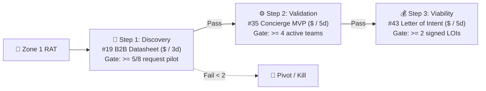

# 🧪 Discovery Framework: Osterwalder 44-Experiment Selector & Sequencing Engine

## 1. 🧠 Mental Model & Trigger Conditions

### Theoretical Foundation
Inspired by **David J. Bland** and **Alexander Osterwalder** (*Testing Business Ideas*, Strategyzer), the Experiment Selector bridges **Assumption Mapping** (identifying Zone 1 Riskiest Assumptions) and **Empirical Validation** (selecting and sequencing the optimal test from 44 canonical experiments).

It enforces four rules:
1. **Risk-to-Method Alignment**: Target the specific risk under threat—**Desirability (D)** (Do they want it?), **Viability (V)** (Will they pay?), **Feasibility (F)** (Can we build/scale it?), or **Usability (U)** (Can they use it intuitively?).
2. **Evidence Strength ("Say" vs. "Do")**:
   - **Weak (1–2)**: *What people say* (interviews, surveys). Good for problem discovery; invalid for proving willingness to pay.
   - **Moderate (3)**: *Simulated choices / low-stakes actions* (card sorting, CTA clicks, Fake Door, prototype tasks).
   - **Strong (4–5)**: *High-stakes skin in the game* (signed B2B LOI, Pre-Order payment, Concierge/Wizard-of-Oz retention).
3. **B2B vs. B2C Fit**: High-traffic ad split-tests or crowdfunding fit B2C/PLG, whereas Enterprise B2B relies on **Datasheets (#19)**, **Buy-a-Feature (#17)**, **Concierge MVPs (#35)**, and **Letters of Intent (#43)**.
4. **Iterative Sequencing (Discovery ➔ Validation)**: Chain a fast, cheap **Discovery Experiment** into a high-evidence **Validation Experiment**.

### Primary Purpose
To deterministically match any product idea or Zone 1 risky assumption against Osterwalder & Bland's 44 experiments by **Risk Type (`D/V/F/U`)**, **Market (`B2B/B2C`)**, **Cost/Time**, and **Evidence Strength**, outputting the **Top 2–3 Matched Experiments** and a **2-Step Sequence** without context bloat.

### Trigger Conditions
- Executing Stage 3 (`Formulate Experiment Blueprints`) of `/validate-idea`.
- Asking `/recommend-framework` or `/apply-framework` how to test a business idea or hypothesis.
- Following [`frameworks/discovery/assumption-mapping.md`](file:///home/marcin/Documents/Projects/ai-pm-sidekick/frameworks/discovery/assumption-mapping.md) to design tests for Zone 1 RATs.

---

## 2. 📥 Required `.context/` Inputs & Socratic Questions

### Mandatory Context Inputs
- [`.context/product.md`](file:///home/marcin/Documents/Projects/ai-pm-sidekick/.context/product.md): Target personas, B2B/B2C motion, and North Star metrics.
- [`.context/discovery.md`](file:///home/marcin/Documents/Projects/ai-pm-sidekick/.context/discovery.md): Existing interview evidence and OST opportunities.
- [`.context/strategy-and-constraints.md`](file:///home/marcin/Documents/Projects/ai-pm-sidekick/.context/strategy-and-constraints.md): Budget, team capacity, and security constraints.

### Socratic Inquiry
1. **Risk-Lens Check**: *"Is the #1 fatal risk Desirability, Viability (pricing), Feasibility (tech/API), or Usability?"*
2. **Market Filter**: *"Are we targeting B2B decision-makers (low volume, high ACV) or B2C / self-serve PLG users?"*
3. **Say-vs-Do Escalation**: *"Do we have zero evidence (need Discovery) or verbal interest (must escalate to behavioral Validation)?"*
4. **Time/Cost Ceiling**: *"What is our timebox before the next decision gate: 48 hours, 1 week, or 2+ weeks?"*

---

## 3. ⚙️ Step-by-Step Execution & Complete 44-Experiment Catalog

### Phase 1: Classify the Input Vector
Extract 4 coordinates: `Risk` (`D|V|F|U`), `Market` (`B2B|B2C|Both`), `Timebox` (`Hours|Days|Weeks`), and `Stage` (`Discovery|Validation`).

### Phase 2: Query the 44-Experiment Catalog Matrix
Select the **Top 2–3 Best-Fit Experiments** from the 8 canonical families below:

#### Part A: Discovery Experiments (#01–#20) — *Uncover Struggles, Signals & Constraints*

| # | Experiment Name | Family | Risk | Market | Cost | Time | Evid (1–5) | Best Trigger / Use Case | Paired Skill |
| :--- | :--- | :--- | :---: | :---: | :---: | :---: | :---: | :--- | :--- |
| **01** | **Customer Interview** *(Mom Test)* | 1. Interviews | D | Both | $ | Days | 2 (Say) | Uncovering past behavior & workarounds | `/prepare-user-interview` |
| **02** | **Partner & Supplier Interview** | 1. Interviews | F/V | B2B | $ | Days | 2 (Say) | Supply chain, API, or channel readiness | `/prepare-user-interview` |
| **03** | **Expert Stakeholder Interview** | 1. Interviews | F/D | Both | $ | Days | 2 (Say) | Domain/regulatory bottlenecks pre-build | `/prepare-user-interview` |
| **04** | **Sales Force Feedback** | 1. Interviews | D/V | B2B | $ | Hours | 2 (Say) | Mining recurring objections & lost deals | `/triage-feedback` |
| **05** | **A Day in the Life** *(Shadowing)* | 2. Observation | D/U | Both | $ | Days | 3 (Obs) | Watching real user workflow hacks live | `/ingest-context` |
| **06** | **Discovery Survey** *(Screener)* | 2. Observation | D | Both | $ | Days | 1 (Say) | Quantifying past behaviors at scale | `/prepare-user-interview` |
| **07** | **Customer Support Analysis** | 2. Observation | D/U | Both | $ | Hours | 3 (Obs) | Clustering support tickets & complaints | `/triage-feedback` |
| **08** | **Extreme User Interview** | 2. Observation | D/F | Both | $ | Days | 2 (Say) | Studying power-users with custom hacks | `/prepare-user-interview` |
| **09** | **Search Trend Analysis** | 3. Digital Signal | D | B2C/PLG | $ | Hours | 2 (Obs) | Measuring keyword search demand volume | `/validate-idea` |
| **10** | **Web Traffic / Funnel Analytics** | 3. Digital Signal | D/U | Both | $ | Hours | 3 (Do) | Auditing drop-offs or high-intent pages | `/define-metrics-and-experiment` |
| **11** | **Online Forum / Review Mining** | 3. Digital Signal | D | Both | $ | Hours | 2 (Obs) | Scraping 1–3 star competitor reviews | `/analyze-competitor` |
| **12** | **Link Tracking** | 3. Digital Signal | D | Both | $ | Hours | 3 (Do) | Tracking value-prop link clicks in emails | `/define-metrics-and-experiment` |
| **13** | **Paper Prototype / Sketch** | 4. Co-Creation | D/U | Both | $ | Hours | 2 (Say) | Testing rough layout & flow fast | `/create-design-brief` |
| **14** | **Storyboard** | 4. Co-Creation | D | Both | $ | Days | 2 (Say) | Validating trigger-to-outcome narrative | `/create-design-brief` |
| **15** | **Card Sorting** | 4. Co-Creation | U/D | Both | $ | Hours | 3 (Choice) | Structuring IA or priority hierarchy | `/create-design-brief` |
| **16** | **Speedboat** *(Anchor Game)* | 4. Co-Creation | D | B2B | $ | Hours | 2 (Choice) | Workshop to rank top workflow pains | `/brainstorm` |
| **17** | **Buy a Feature** *(Budget Game)* | 4. Co-Creation | D/V | B2B/Both | $ | Days | 3 (Choice) | Customers allocate limited fake budget | `/apply-framework` (`moscow`) |
| **18** | **Product Box** | 4. Co-Creation | D/V | Both | $ | Days | 2 (Say) | Testing core positioning hooks & appeal | `/apply-framework` (`positioning`) |
| **19** | **Datasheet / Brochure** | 4. Co-Creation | D/V/F | **B2B** | $ | Hours | 3 (Commit) | Reviewing specs & ROI with B2B buyers | `/create-prd` (`lean`) |
| **20** | **Boomerang** *(Competitor Test)* | 4. Co-Creation | D/U | Both | $ | Hours | 3 (Obs) | Watching users use a competitor tool | `/analyze-competitor` |

#### Part B: Validation Experiments (#21–#44) — *Prove Demand with Behavioral Skin-in-the-Game*

| # | Experiment Name | Family | Risk | Market | Cost | Time | Evid (1–5) | Best Trigger / Use Case | Paired Skill |
| :--- | :--- | :--- | :---: | :---: | :---: | :---: | :---: | :--- | :--- |
| **21** | **Simple Landing Page** | 5. Campaigns | D/V | B2C/PLG | $ | Days | 3 (Do) | Measuring CTA signup conversion rate | `/create-mockup` |
| **22** | **Split (A/B) Landing Page** | 5. Campaigns | D/V | B2C/PLG | $$ | Days | 4 (Do) | Comparing positioning angles or pricing | `/define-metrics-and-experiment` |
| **23** | **Online Ad Campaign** | 5. Campaigns | D | B2C/PLG | $$ | Days | 3 (Do) | Testing hook CTR across target segments | `/define-metrics-and-experiment` |
| **24** | **Email Campaign** *(Outbound)* | 5. Campaigns | D | **B2B**/Both | $ | Days | 3 (Do) | Testing B2B resonance via reply/book rate | `/define-metrics-and-experiment` |
| **25** | **Social Media Campaign** | 5. Campaigns | D | B2C/PLG | $ | Days | 3 (Do) | Testing organic community pull & waitlist | `/plan-launch` |
| **26** | **Referral / Viral Loop Test** | 5. Campaigns | D/V | B2C/PLG | $$ | Weeks | 4 (Do) | Validating K-factor & referral willingness | `/apply-framework` (`aarrr`) |
| **27** | **Explainer Video** *(Dropbox)* | 5. Campaigns | D/U | Both | $$ | Days | 4 (Do) | Complex unbuilt tech proven via video | `/create-mockup` |
| **28** | **Fake Door / 404 Feature Test** | 5. Campaigns | D | Both | $ | Hours | 4 (Do) | In-app button for unbuilt feature clicks | `/define-metrics-and-experiment` |
| **29** | **Clickable Digital Prototype** | 6. Prototypes | U/D | Both | $ | Hours | 3 (Do) | Testing UI flow, tasks & edge cases | `/create-mockup` |
| **30** | **3D Print / Physical Model** | 6. Prototypes | F/U | Hardware | $$ | Days | 3 (Do) | Ergonomic & physical form validation | `/create-design-brief` |
| **31** | **Life-Size Prototype** | 6. Prototypes | U/D | Physical | $$ | Days | 3 (Do) | Spatial/service workflow walk-through | `/create-design-brief` |
| **32** | **Technical Spike / API PoC** | 6. Prototypes | **F** | Both | $ | Hours | 4 (Feas) | Verifying latency, LLM accuracy, or APIs | `/create-documentation` |
| **33** | **Pinocchio Experiment** | 6. Prototypes | D/U | Both | $ | Days | 3 (Do) | Testing habit formation with prop object | `/validate-idea` |
| **34** | **Wizard of Oz** | 6. Prototypes | D/F | Both | $$ | Weeks | 4 (Do) | Automated front-end; human back-end | `/create-mockup` |
| **35** | **Concierge MVP** | 6. Prototypes | D/V | **B2B**/Both | $ | Days | 4 (Do) | Delivering outcome manually white-glove | `/validate-idea` |
| **36** | **Mashup MVP** *(No-Code)* | 7. Live MVPs | D/F/V | Both | $$ | Days | 4 (Do) | Stitching off-the-shelf tools pre-code | `/create-prd` (`lean`) |
| **37** | **Single-Feature MVP** | 7. Live MVPs | D/U/F | Both | $$$ | Weeks | 5 (Do) | Shipping only 1 core value loop live | `/create-user-stories` |
| **38** | **Pop-Up Store / Event Booth** | 7. Live MVPs | D/V | B2B/B2C | $$ | Days | 4 (Do) | Live demoing at industry conference | `/plan-launch` |
| **39** | **Impersonator** *(Re-skin)* | 7. Live MVPs | D/V | Both | $$ | Days | 4 (Pay) | Wrapping existing product under brand | `/create-mockup` |
| **40** | **Mock Sale / Checkout Test** | 8. Pre-Sales | **V** | B2C/PLG | $ | Days | 5 (Pay) | Pricing page "Buy Now" click pre-billing | `/create-mockup` |
| **41** | **Pre-Order** | 8. Pre-Sales | **V** | B2C/PLG | $$ | Weeks | 5 (Pay) | Collecting credit card deposits pre-build | `/define-metrics-and-experiment` |
| **42** | **Crowdfunding** | 8. Pre-Sales | **V**/D | B2C | $$$ | Weeks | 5 (Pay) | Mass market funding threshold campaign | `/plan-launch` |
| **43** | **Letter of Intent (LOI)** | 8. Pre-Sales | **V** | **B2B** | $ | Days | 5 (Pay) | B2B buyer signs purchase intent contract | `/create-prd` |
| **44** | **Van Westendorp / Paid Pilot** | 8. Pre-Sales | **V** | **B2B**/Both | $ | Days | 4 (Pay) | Price threshold survey or paid B2B beta | `/apply-framework` (`pricing`) |

---

### Phase 3: Sequencing Heuristics & Anti-Gaming Rules

1. **Prescribe a 2-to-3 Step Experiment Chain**:
   - **B2B Enterprise Chain**: `#01 Customer Interview` (Days 1–3) ➔ `#19 Datasheet` or `#29 Clickable Prototype` (Days 4–6) ➔ `#35 Concierge MVP` or `#43 Letter of Intent (LOI)` (Week 2).
   - **B2C / PLG Self-Serve Chain**: `#09/#11 Search & Review Mining` (Day 1) ➔ `#21/#28 Fake Door or Smoke Landing Page` (Days 2–4) ➔ `#40 Mock Sale` or `#36 Mashup MVP` (Week 2).
   - **Technical / AI Feasibility Chain**: `#08 Extreme User Interview` (Day 1) ➔ `#32 Technical Spike / API PoC` (Day 2) ➔ `#34 Wizard of Oz` (Week 1–2).
2. **Strict Anti-Gaming Rules**:
   - **No Opinion Viability**: NEVER use `#01 Interview` or `#06 Survey` alone for **Viability (Pricing)** risks. Escalate to Family 8 (`#40 Mock Sale`, `#41 Pre-Order`, `#43 LOI`, `#44 Paid Pilot`) or `#17 Buy-a-Feature`.
   - **No B2C Mismatch**: NEVER prescribe `#23 Online Ads` or `#42 Crowdfunding` for Enterprise B2B personas. Route B2B to `#19 Datasheet`, `#24 Outbound Email`, `#35 Concierge`, or `#43 LOI`.
   - **Top-3 Context Guardrail**: NEVER dump all 44 rows into user deliverables. Output only the **Top 2–3 Matched Experiments + 1 Sequencing Chain**.

---

## 4. 📊 Output Format

### 1. Matched Experiment Selection Table
```markdown
| Step | Experiment (#/44) | Risk & Market Fit | Evidence (1–5) | Time & Cost | Target Metric & Kill Threshold | Paired Skill |
| :--- | :--- | :--- | :--- | :--- | :--- | :--- |
| **1. Discovery** | **#19 Datasheet / Brochure** | Desirability & Viability (B2B) | 3/5 (Commit) | 3d (`$`) | $\ge 5/8$ prospects request pilot access; Kill if $< 2$ engage. | `/create-prd --mode lean` |
| **2. Validation** | **#35 Concierge MVP** | Desirability & Usability (B2B) | 4/5 (Do) | 5d (`$`) | $\ge 4$ teams submit real sprint backlogs for manual run. | `/validate-idea` |
| **3. Viability** | **#43 Letter of Intent (LOI)** | Viability (B2B Revenue) | 5/5 (Pay) | 5d (`$`) | $\ge 2$ prospects sign $299/mo paid pilot LOI. | `/define-metrics-and-experiment` |
```

### 2. Experiment Sequencing Flow (Mermaid)


---

## 5. ✍️ `.context/` Write-Back Target

- **Primary Target**: [`.context/discovery.md`](file:///home/marcin/Documents/Projects/ai-pm-sidekick/.context/discovery.md) (Append selected experiment sequence and kill thresholds under `## 🌳 2. Opportunity Solution Tree (OST)` or `## 🔬 Active Hypotheses & Assumption Mapping (RAT)`).
- **Secondary Target**: Stage Go/Pivot/No-Go decisions in `.context/.inbox/` for [`.context/decisions.md`](file:///home/marcin/Documents/Projects/ai-pm-sidekick/.context/decisions.md).
