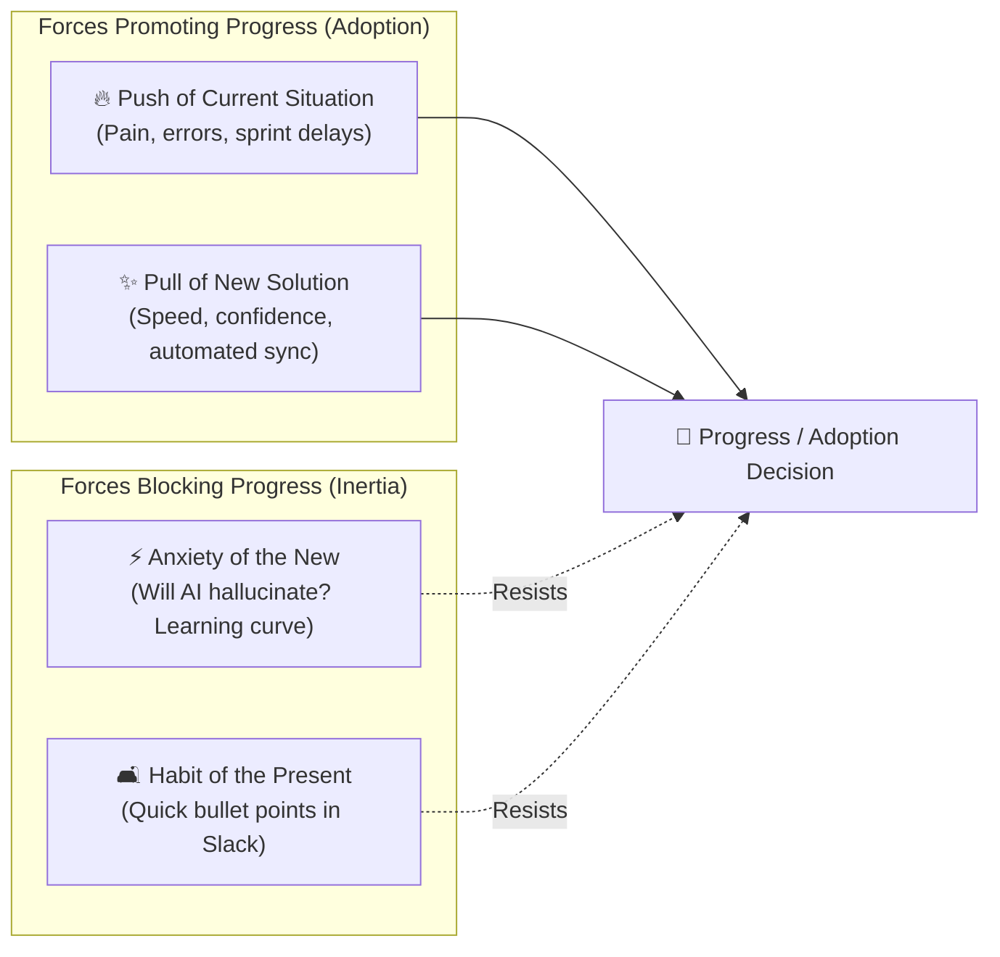

# 🗣️ Discovery Framework: Jobs-to-be-Done (JTBD) & The Mom Test

## 1. 🧠 Mental Model & Trigger Conditions

### Theoretical Foundation
This framework fuses two complementary customer discovery disciplines:
1. **Jobs to Be Done (JTBD)** (Clayton Christensen, Bob Moesta): Customers do not buy products; they "hire" them to make progress in a specific life or workflow circumstance. Customer choices are driven by **Functional**, **Emotional**, and **Social** dimensions, governed by the **Four Forces of Progress**.
2. **The Mom Test** (Rob Fitzpatrick): A methodology for customer interviewing designed to extract verifiable behavioral facts from the past, completely neutralizing false compliments, opinions, and hypothetical promises.

### Primary Purpose
To uncover genuine customer demand by systematically filtering out false validation, identifying real customer struggle, and structuring value propositions around the forces that drive adoption.

### Trigger Conditions
Apply this framework when:
- Conducting customer problem discovery or user interview synthesis in `/validate-idea`.
- Writing the Problem Statement, Executive Summary, or Target Persona sections in `/create-prd`.
- A feature concept sounds promising but lacks demonstrable evidence of customer budget or behavior change.
- Diagnosing why a released feature suffers from low user adoption despite positive survey feedback.

---

## 2. 📥 Required `.context/` Inputs & Socratic Questions

### Mandatory Context Inputs
- [`.context/product.md`](file:///home/marcin/Documents/Projects/ai-pm-sidekick/.context/product.md): Target personas, core value loops, and strategic mission.
- [`.context/discovery.md`](file:///home/marcin/Documents/Projects/ai-pm-sidekick/.context/discovery.md): Existing interview evidence log and JTBD canvases.

### Socratic Inquiry
The AI agent must interrogate raw customer feedback using these diagnostic questions:
1. **The Past Behavior Test**: *"Did the interviewee describe an actual event that happened in the past, or were they speaking in generic abstractions ('I usually...')?"*
2. **The Skin-in-the-Game Test**: *"What money, time, or bespoke workarounds has this customer already invested to solve this problem?"*
3. **The Compliment Filter**: *"Did we ask an open past question, or did we pitch an idea and solicit polite praise ('Do you think this is a good idea?')?"*
4. **The Four Forces Balance**: *"Does the combined momentum of the Push and Pull decisively outweigh the inertia of Habit and the Anxiety of the new?"*

---

## 3. ⚙️ Step-by-Step Execution & Scoring Rubric

### Phase 1: The Mom Test Qualitative Synthesis
Classify every interview insight into one of three strict validation tiers:

| Evidence Tier | Data Quality | Observable Indicators | Weight |
| :--- | :--- | :--- | :--- |
| **Tier 1: Hard Behavioral Evidence** | High | Customer spent company budget, built a custom spreadsheet/script, or experienced verifiable business loss in the past 14 days. | **1.0 (Valid)** |
| **Tier 2: Observed Friction** | Moderate | Customer experienced frustration but developed no workaround and spent $0 trying to fix it. | **0.5 (Inconclusive)** |
| **Tier 3: Fluff & Hypotheticals** | Zero | Customer gave compliments (*"That sounds amazing!"*), generic opinions, or hypothetical future promises (*"I'd pay for that"*). | **0.0 (DISCARD)** |

#### Red Flag Deflections:
- **Fluff**: *"I'm always looking for better PM tools."* ➔ Deflection: *"When was the last time you evaluated a PM tool? Which one did you adopt?"*
- **Hypothetical**: *"I would definitely use an automated Gherkin writer."* ➔ Deflection: *"How do you write Gherkin test scenarios today? Who wrote the last one?"*
- **Compliment**: *"This mock UI looks super sleek!"* ➔ Deflection: Ignore the compliment and probe: *"Where does your current workflow break down when doing this task?"*

---

### Phase 2: Jobs to Be Done (JTBD) Canvas Construction

#### 1. The Core Job Statement:
```
When [Specific triggering circumstance & context],
I want to [Specific functional motivation & progress],
So that I can [Measurable business or personal outcome].
```

#### 2. The 3 Job Dimensions:
- **Functional Job**: The practical, tangible task the user must complete.
- **Emotional Job**: How the user needs to feel (e.g., confident, in control, relieved of anxiety).
- **Social Job**: How the user wants to be perceived by team members, management, or peers.

#### 3. The Four Forces of Progress Equation:
Progress occurs if and only if:
$$\mathbf{(Push + Pull) > (Anxiety + Habit)}$$



---

## 4. 📊 Output Format (Markdown Table & JTBD Canvas)

### 1. Synthesized Interview Evidence Table
```markdown
| Interviewee | Segment | Trigger Event (Past Specifics) | Action Taken / Workaround | Evidence Tier | Hard Quote / Behavior |
| :--- | :--- | :--- | :--- | :--- | :--- |
| **PM #X** | Growth SaaS | Sprint 42 planning last Thursday | Built custom 12-column Notion table | Tier 1 (Hard) | *"We lost 3 days because payment timeouts weren't specified."* |
```

### 2. Standard JTBD Canvas
```markdown
### 🎯 JTBD Canvas: [Job Name]
- **Job Statement**: When `[trigger]`, I want to `[action]`, so that I can `[outcome]`.
- **Functional Dimension**: `[Specific task to execute]`
- **Emotional Dimension**: `[Internal feeling: peace of mind, fear of public mistakes]`
- **Social Dimension**: `[External perception: viewed as structured and engineering-friendly]`
- **The Four Forces Balance**:
  - *Push*: `[Current operational pain & friction points]`
  - *Pull*: `[Compelling appeal of the proposed solution]`
  - *Anxiety*: `[Fears, switching risks, or skepticism]`
  - *Habit*: `[Current comfortable workarounds and defaults]`
```

---

## 5. ✍️ `.context/` Write-Back Target

- **Target File**: [`.context/discovery.md`](file:///home/marcin/Documents/Projects/ai-pm-sidekick/.context/discovery.md)
- **Target Sections**:
  - `## 🗣️ 3. The Mom Test — Customer Interview Evidence` (Append new Tier 1 behavioral insights).
  - `## 📦 4. Jobs to Be Done (JTBD) Canvas` (Update or refine the primary job canvas).
