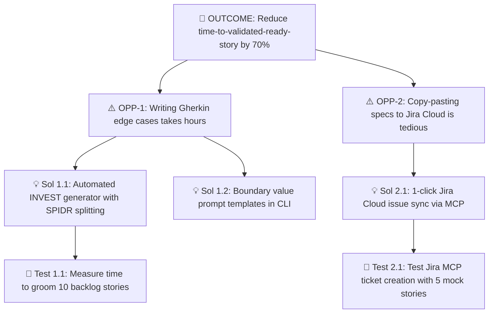

# 🌳 Discovery Framework: Opportunity Solution Tree (OST)

## 1. 🧠 Mental Model & Trigger Conditions

### Theoretical Foundation
Originated by **Teresa Torres** in *Continuous Discovery Habits*, the Opportunity Solution Tree (OST) is a visual mental model that forces product teams to decouple **business outcomes** from **candidate solutions** by introducing a crucial intermediate layer: **customer opportunities**.

```
[1. Desired Outcome]
       ├── [2. Customer Opportunity A]
       │          ├── [3. Solution A.1] ── [4. Assumption Test A.1.a]
       │          └── [3. Solution A.2] ── [4. Assumption Test A.2.a]
       └── [2. Customer Opportunity B]
                  └── [3. Solution B.1] ── [4. Assumption Test B.1.a]
```

### Primary Purpose
To break the "feature factory" anti-pattern by ensuring teams explore the problem space thoroughly, evaluate multiple competing solutions for each customer pain point, and test assumptions before committing engineering resources.

### Trigger Conditions
Apply this framework when:
- Setting quarterly product discovery tracks or defining feature roadmaps.
- Initiating discovery in `/validate-idea` or brainstorming in `/brainstorm`.
- A stakeholder or customer requests a specific feature (*"We need an AI summary dashboard"*) without articulating the underlying problem.
- Prioritizing which customer problems deserve PRDs in `/create-prd`.

---

## 2. 📥 Required `.context/` Inputs & Socratic Questions

### Mandatory Context Inputs
- [`.context/product.md`](file:///home/marcin/Documents/Projects/ai-pm-sidekick/.context/product.md): Vision, target personas, North Star metric, and OKRs.
- [`.context/discovery.md`](file:///home/marcin/Documents/Projects/ai-pm-sidekick/.context/discovery.md): Active outcomes (`OUT-01` to `OUT-03`) and past customer interview evidence.

### Socratic Inquiry
The AI agent must rigorously enforce problem/solution separation using these questions:
1. **The Outcome Anchor**: *"Which specific outcome metric does this initiative move, and how is it measured?"*
2. **The 'Feature-in-Disguise' Test**: *"Is this statement framed as a genuine customer pain point ('I struggle to...'), or is it a solution in disguise ('Customers need an export button')?"*
3. **The Multiplicity Test**: *"Have we brainstormed at least 3 distinct ways to address this opportunity before anchoring on this single feature?"*
4. **The Fastest Test**: *"What is the single most fatal leap-of-faith assumption underlying this solution, and what is the fastest test (under 48 hours, no production code) to validate it?"*

---

## 3. ⚙️ Step-by-Step Execution & Scoring Rubric

### Step 1: Set the Top-Level Desired Outcome
Select exactly **one** measurable outcome metric from `.context/discovery.md` (e.g., *Reduce PM spec authoring time by 75%*). Do not combine multiple competing goals into one tree.

### Step 2: Map the Opportunity Space (Customer Pains & Needs)
- Synthesize customer interviews, support tickets, and telemetry.
- **Strict Opportunity Phrasing Rule**: Every opportunity must be phrased from the first-person perspective:
  - ✅ *"I struggle to remember all negative test edge cases when writing tickets."*
  - ❌ *"Build an automated Gherkin test generator."* (Feature in disguise!)
- Decompose broad opportunities into sub-opportunities until they are actionable.

### Step 3: Generate Diverse Solutions
For the highest-priority opportunity, generate **at least 2–3 distinct solutions**:
- One UX / interface solution (e.g., visual wizard or sidepanel).
- One process / template automation solution (e.g., Gherkin rubric).
- One API / data integration solution (e.g., direct MCP sync).

### Step 4: Decompose Solutions into 5 Assumption Types
Before building, extract and test the riskiest assumptions:
1. **Desirability**: Do customers actually want this? Will they change their behavior?
2. **Viability**: Does this align with our business model, pricing, and compliance?
3. **Feasibility**: Can our existing technical stack and architecture support this within sprint limits?
4. **Usability**: Can the user successfully navigate and complete the flow without assistance?
5. **Ethical / Safety**: Does this risk user privacy, security, or data contamination?

---

## 4. 📊 Output Format (Markdown Table & Mermaid Diagram)

### 1. Visual Opportunity Solution Tree (Mermaid)


### 2. Opportunity Evaluation Matrix
```markdown
| Opportunity ID | Customer Need / Pain Statement | Target Solution Candidates | Riskiest Assumption | Fastest Test Method |
| :--- | :--- | :--- | :--- | :--- |
| **OPP-[X]** | *"When I [situation], I struggle to [pain]..."* | 1. [Sol A]<br>2. [Sol B]<br>3. [Sol C] | [Desirability / Feasibility assumption] | [Mom test interview / clickable mockup / spike] |
```

---

## 5. ✍️ `.context/` Write-Back Target

- **Target File**: [`.context/discovery.md`](file:///home/marcin/Documents/Projects/ai-pm-sidekick/.context/discovery.md)
- **Target Section**: `## 🌳 2. Opportunity Solution Tree (OST)`
- **Update Protocol**:
  1. Add newly verified customer opportunities under the active outcome.
  2. Reject any opportunity that fails the "Feature-in-Disguise" test.
  3. Update solution nodes with active experiment results (Validated / Invalidated).
