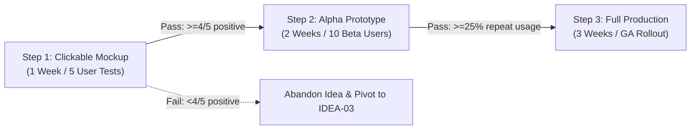

# 💡 Operational Framework: GIST Planning (Iterative Outcome Execution)

## 1. 🧠 Mental Model & Trigger Conditions

### Theoretical Foundation
Developed by **Itamar Gilad** (former Google Head of Product), **GIST Planning** eliminates rigid, speculative long-term roadmaps by replacing them with four agile, lightweight planning layers:
1. **Goals (Years / Quarters)**: The strategic destination defined by quantitative Key Results / OKRs (What outcome do we need?).
2. **Ideas (Dynamic Backlog)**: Hypotheses on how to achieve the goals. Ideas are cheap, collected continuously, and prioritized via ICE scoring (Impact, Confidence, Ease). Most ideas are expected to fail or be abandoned.
3. **Step-projects (Weeks / Days)**: Small, non-linear experiments designed to validate an Idea in sequential stages (e.g. Prototype $\to$ Alpha $\to$ Beta $\to$ Full Rollout). No step-project exceeds 2–4 weeks. If an early step disproves the idea, the idea is dropped immediately.
4. **Tasks (Days / Hours)**: Daily sprint activities and engineering tickets executing the active step-project.

### Primary Purpose
To drastically reduce product waste by testing ideas through tiny step-projects before committing full engineering squads to building multi-month feature implementations.

### Trigger Conditions
Apply this framework when:
- Operating under `operating_model: gist` in `.context/harness-config.yaml`.
- Reconciling quarterly OKRs with tactical sprint initiatives in `/create-prd` or `/validate-idea`.
- An initiative has high uncertainty and stakeholders demand proof before full development funding.
- Breaking down speculative annual roadmaps into fast, testable outcome iterations.

---

## 2. 📥 Required `.context/` Inputs & Socratic Questions

### Mandatory Context Inputs
- [`.context/product.md`](file:///home/marcin/Documents/Projects/ai-pm-sidekick/.context/product.md): Core vision, active quarterly OKRs, and North Star metric.
- [`.context/discovery.md`](file:///home/marcin/Documents/Projects/ai-pm-sidekick/.context/discovery.md): Customer interview evidence and opportunity solution trees.
- [`.context/strategy-and-constraints.md`](file:///home/marcin/Documents/Projects/ai-pm-sidekick/.context/strategy-and-constraints.md): Strategic trade-offs and capacity limits.

### Socratic Inquiry
The AI agent must interrogate planning proposals using these diagnostic tests:
1. **The Goal Anchoring Test**: *"Which specific Key Result in .context/product.md does this idea target, and what is the current metric baseline?"*
2. **The Step-Project Sizing Test**: *"Is this step-project sized to complete in $\le 2$ weeks, or did the team sneak a full 3-month production build into the first step?"*
3. **The Pivot / Kill Threshold**: *"What quantitative threshold (e.g., 20% conversion or 5 user interviews) must this step-project achieve to earn the right to advance to the next step?"*
4. **The Idea Multiplicity Test**: *"Do we have at least 3 competing ideas competing to achieve this single Goal, or did we bet the entire quarter on one speculative solution?"*

---

## 3. ⚙️ Step-by-Step Execution & Scoring Rubric

### Step 1: Define the Quantified Goal (G)
Anchor on an active OKR from `.context/product.md`:
$$\text{Goal} = \text{Improve [Metric]} \text{ from [Baseline]} \text{ to [Target]} \text{ by [Date]}$$

### Step 2: Harvest & Score Competing Ideas (I) via ICE
Rank candidate ideas using the lightweight ICE framework ($1–10$ scale):
$$\mathbf{ICE\ Score} = \mathbf{Impact} \times \mathbf{Confidence} \times \mathbf{Ease}$$
- **Impact (1–10)**: How much will this move the Goal?
- **Confidence (1–10)**: What empirical evidence supports this (1 = pure guess, 10 = verified live data)?
- **Ease (1–10)**: How fast and cheap can we test it (10 = under 2 days, 1 = months of work)?

### Step 3: Sequence Step-Projects (S)
For top ICE ideas, structure 3 progressive validation steps:
- **Step 1: Smoke / Prototype Test ($\le 1$ week)**: Clickable mockup, fake door test, or 5 customer interviews.
- **Step 2: Alpha Slice ($\le 2$ weeks)**: Scrappy, minimal functional version with 10 design partners.
- **Step 3: Beta / Production Scale (2–4 weeks)**: Hardened production release with telemetry and automated tests.

### Step 4: Decompose Current Step into Tasks (T)
Derive daily sprint tasks for the active step-project only. Do not plan tasks for future step-projects.

---

## 4. 📊 Output Format (GIST Plan Schema)

```markdown
# 💡 GIST Execution Plan: [Goal Name]

### 🎯 1. Goal (Target OKR)
- **Outcome Objective**: [Target outcome from .context/product.md]
- **Target Metric**: Increase [Metric] from [Baseline] to [Target] by [Date]

### 💡 2. Idea Backlog & ICE Ranking
| Idea ID | Idea Description | Impact (1–10) | Confidence (1–10) | Ease (1–10) | ICE Score | Status |
| :--- | :--- | :---: | :---: | :---: | :---: | :--- |
| **IDEA-01** | [Core Hypothesis 1] | 8 | 4 | 8 | **256** | Active Step |
| **IDEA-02** | [Alternative Approach 2] | 7 | 3 | 9 | **189** | Queued |
| **IDEA-03** | [Low-effort experiment] | 5 | 5 | 8 | **200** | Next |

### 🪜 3. Step-Projects for Active Idea (IDEA-01)


### 📋 4. Active Tasks (Step 1)
- [ ] Task 1.1: Build clickable Tailwind mockup via `/create-mockup`.
- [ ] Task 1.2: Conduct 5 Mom Test interviews via `/validate-idea`.
- [ ] Task 1.3: Tabulate validation gate results and update `.context/discovery.md`.
```

---

## 5. ✍️ `.context/` Write-Back Target

- **Target File**: [`.context/product.md`](file:///home/marcin/Documents/Projects/ai-pm-sidekick/.context/product.md)
- **Target Section**: `## 5. OKRs & Quarterly Commitments`
- **Persistence Protocol**: Synchronize the validated Idea states, step-project outcomes, and metric progress back into the active OKR tracking table.
