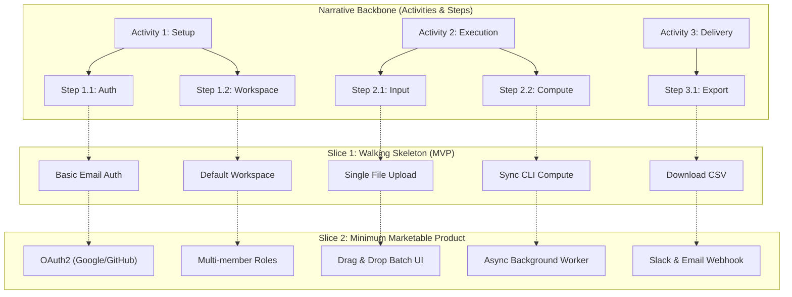

# 🗺️ Operational Framework: User Story Mapping (Jeff Patton)

## 1. 🧠 Mental Model & Trigger Conditions

### Theoretical Foundation
Originated by **Jeff Patton** in *User Story Mapping*, this framework visualizes the product backlog as a two-dimensional narrative map rather than a linear list:
1. **Horizontal Dimension (Narrative Backbone)**: Represents the customer journey over time, organized hierarchically by **Activities** (high-level goals) and **Steps / Tasks** (sequential actions taken to achieve that activity).
2. **Vertical Dimension (Release Slices / Depth)**: Arranges story details by priority, criticality, and sophistication. The top horizontal slice represents the **Walking Skeleton / MVP**, followed by subsequent release increments (`Release 1.1`, `Release 2.0`).

```
[ Activities (High-Level) ]  ===>   Activity 1     ───▶     Activity 2     ───▶     Activity 3
[ Steps / Backbone (Time) ]  ===> Step 1.1 ──▶ Step 1.2   Step 2.1 ──▶ Step 2.2   Step 3.1 ──▶ Step 3.2
═══════════════════════════════════════════════════════════════════════════════════════════════════════
[ Slice 1: Walking Skeleton ]      Story A1    Story A2      Story B1    Story B2      Story C1    Story C2
───────────────────────────────────────────────────────────────────────────────────────────────────────
[ Slice 2: Minimum Marketable ]    Story A3    Story A4      Story B3    Story B4      Story C3    Story C4
───────────────────────────────────────────────────────────────────────────────────────────────────────
[ Slice 3: Delighters / Future ]   Story A5                  Story B5                  Story C5    Story C6
```

### Primary Purpose
To eliminate "flat backlog blindness", ensure teams ship complete, coherent end-to-end user journeys rather than disconnected vertical feature fragments, and establish clear release boundaries based on value increments.

### Trigger Conditions
Apply this framework when:
- Planning a 0-to-1 product or a major new workflow in `/create-prd` or `/create-user-stories`.
- Scope negotiations stall because stakeholders cannot agree on what constitutes a minimal viable release.
- Backlogs have grown unmanageable or disorganized in `BACKLOG.md`.
- Structuring multi-sprint milestones into an outcome roadmap in `/create-roadmap`.

---

## 2. 📥 Required `.context/` Inputs & Socratic Questions

### Mandatory Context Inputs
- [`.context/product.md`](file:///home/marcin/Documents/Projects/ai-pm-sidekick/.context/product.md): Target user personas, primary value propositions, and core job journeys.
- [`.context/conventions.md`](file:///home/marcin/Documents/Projects/ai-pm-sidekick/.context/conventions.md): Definition of Ready (DoR), tier rules (Lean vs Standard Agile), and story sizing guidelines.
- [`.context/discovery.md`](file:///home/marcin/Documents/Projects/ai-pm-sidekick/.context/discovery.md): Customer interview quotes, known pain points, and user goals.

### Socratic Inquiry
1. **The End-to-End Test**: *"If the user completes Slice 1, can they experience full closure of their core job, or will they hit a dead end where manual intervention is required?"*
2. **The Backbone Continuity Test**: *"Are there missing steps in the narrative backbone where we assume user actions that aren't represented in tickets?"*
3. **The Slicing Severity Test**: *"Is this ticket in Slice 1 truly mandatory for survival (Walking Skeleton), or is it an optimization that can wait for Slice 2?"*
4. **The Exception Path Check**: *"Have we mapped user steps when things go wrong (e.g., auth failure, payment decline, empty states), or only the happy path?"*

---

## 3. ⚙️ Step-by-Step Execution & Scoring Rubric

### Phase 1: Establish the Narrative Backbone
1. **Identify the Primary Persona**: Name the exact target persona navigating this workflow from `.context/product.md`.
2. **Map High-Level Activities**: Identify 3 to 6 major milestones the user traverses from left to right (e.g., *Discover ➔ Onboard ➔ Configure ➔ Execute Core Value ➔ Share/Export*).
3. **Decompose into Steps (Narrative Flow)**: Under each activity, list the chronological steps the user performs to complete the activity.

### Phase 2: Card Population & Vertical Depth
1. **Brainstorm User Stories**: For each step, generate concrete stories representing different implementation options, levels of fidelity, or edge cases.
2. **Sort by Necessity**: Within each column (step), stack stories vertically:
   - **Top**: Bare minimum viable functionality (e.g., plain text input, basic SQL query, email notification).
   - **Middle**: Polished UX, automated validations, rich previews, bulk operations.
   - **Bottom**: Advanced heuristics, automated AI suggestions, secondary integrations.

### Phase 3: Horizontal Slicing & Release Boundaries
1. **Slice 1 — Walking Skeleton (MVP)**:
   - Must touch every single activity on the backbone to form an unbroken, functional end-to-end path.
   - Zero frills; purely validates technical feasibility and core workflow viability.
2. **Slice 2 — Minimum Marketable Product (MMP / v1.1)**:
   - Adds necessary hygiene features, competitive baselines, self-serve onboarding, and error tolerance.
3. **Slice 3 — Differentiators & Delighters (v2.0)**:
   - Performance enhancements, advanced automations, personalization, and integrations.

---

## 4. 📊 Output Format

### User Story Map Grid (Markdown Table)

| Activity | Step | Slice 1: Walking Skeleton (MVP) | Slice 2: MMP (v1.1) | Slice 3: Delighters (v2.0) |
| :--- | :--- | :--- | :--- | :--- |
| **1. Ingest Data** | Connect Source | File upload (CSV only) | S3 / Cloud Bucket webhook | Real-time Kafka streaming |
| **1. Ingest Data** | Validate Schema | Basic column presence check | Type checking & auto-coercion | AI schema drift detection |
| **2. Process** | Transform Records | Run batch SQL query | Async queue with progress bar | Distributed worker pool |
| **3. Output** | View Results | Raw HTML data table | Interactive charts & filters | PDF/Excel export + Slack bot |

### Story Map Mermaid Diagram


---

## 5. ✍️ `.context/` Write-Back Target

- **Primary Target File**: [`.context/discovery.md`](file:///home/marcin/Documents/Projects/ai-pm-sidekick/.context/discovery.md) (under `## 🗺️ Active User Story Maps & Release Slices`) or [`BACKLOG.md`](file:///home/marcin/Documents/Projects/ai-pm-sidekick/BACKLOG.md).
- **Write-Back Content**:
  1. Record the horizontal narrative activities and steps.
  2. Document the agreed Walking Skeleton boundary and release commitments.
  3. Map Slice 1 tickets to the active sprint or milestone.
