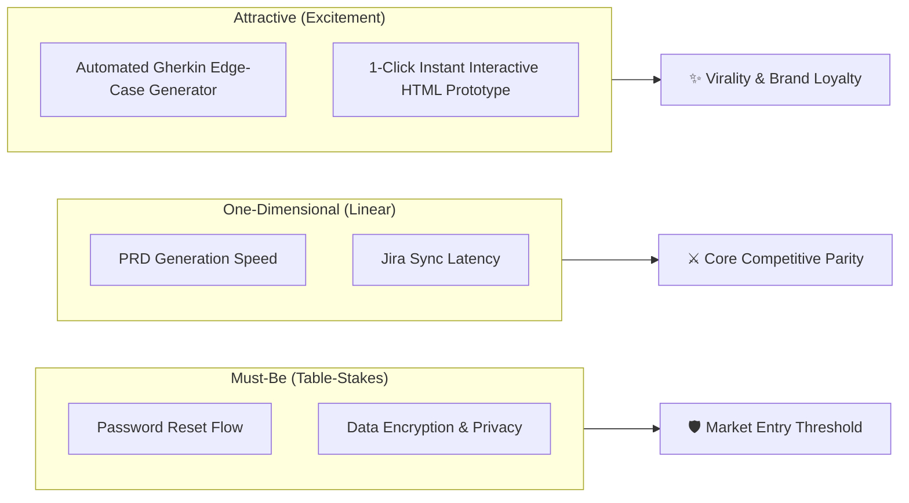

# 🎯 Prioritization Framework: The Kano Model & Customer Delight

## 1. 🧠 Mental Model & Trigger Conditions

### Theoretical Foundation
Developed in 1984 by **Dr. Noriaki Kano**, the Kano Model demonstrates that customer satisfaction is **non-linear**: different product features provoke fundamentally different emotional and behavioral reactions.

Features are classified into five distinct categories based on their presence vs. customer satisfaction:

```
Satisfaction (High)
      ^
      |         /  [Attractive / Delighter] (Unexpected delight)
      |        /
      |       /   [One-Dimensional / Performance] (More is better)
      |      /
Neutral +----------------------------------------------------> Functionality (High)
      |    /
      |   /
      |  /        [Must-Be / Basic] (Taken for granted; outrage if missing)
      v
Dissatisfaction (Low)
```

1. **Must-Be (M) / Basic**: Table-stakes expectations. Taken for granted when present; causes severe customer outrage or churn if missing.
2. **One-Dimensional (O) / Performance**: Linear satisfaction. Customer happiness increases proportionally with speed, efficiency, or capacity (*more is better*).
3. **Attractive (A) / Delighters**: Unexpected innovations. Generates disproportionate delight when present, but creates zero dissatisfaction if absent.
4. **Indifferent (I)**: The customer does not care whether the feature exists or not.
5. **Reverse (R)**: The customer actively prefers the absence of the feature (e.g., intrusive popups).

> [!NOTE]
> **Kano Decay Cycle**: Over time, all Delighters inevitably decay into Performance features, and eventually degrade into Must-Be table-stakes expectations (e.g., smartphone touchscreens, airline Wi-Fi, Dark Mode).

### Primary Purpose
To construct balanced product releases that satisfy table-stakes baseline requirements, compete effectively on performance, and incorporate distinct delighters while aggressively pruning indifferent bloat.

### Trigger Conditions
Apply this framework when:
- Defining the scope of an MVP or new feature tier in `/create-prd` or `/validate-idea`.
- Structuring customer research surveys and validation interviews.
- Deciding whether an engineering proposal represents an essential requirement or an unnecessary luxury.
- Designing competitive differentiation against established market rivals.

---

## 2. 📥 Required `.context/` Inputs & Socratic Questions

### Mandatory Context Inputs
- [`.context/product.md`](file:///home/marcin/Documents/Projects/ai-pm-sidekick/.context/product.md): Target personas, core value loops, and strategic differentiation.
- [`.context/discovery.md`](file:///home/marcin/Documents/Projects/ai-pm-sidekick/.context/discovery.md): Mom Test customer interview insights and JTBD dimensions.

### Socratic Inquiry
The AI agent must probe feature requirements using these questions:
1. **The Absence Test**: *"If we launch this product completely without this feature, will customers refuse to adopt it (Must-Be), or will they not even notice (Indifferent/Delighter)?"*
2. **The Linearity Test**: *"Does doubling the performance or speed of this feature double customer satisfaction, or does satisfaction plateau after reaching a baseline threshold?"*
3. **The Delighter Check**: *"What is the 1 feature in this release that will make users genuinely smile and tell a colleague, which nobody explicitly requested?"*
4. **The Indifference Filter**: *"Are we investing sprint capacity into features that users rank as Indifferent?"*

---

## 3. ⚙️ Step-by-Step Execution & Scoring Rubric

### Step 1: Formulate Functional & Dysfunctional Question Pairs
For every candidate feature, administer two standardized questions:
- **Functional Question**: *"How would you feel if the product HAS this feature?"*
- **Dysfunctional Question**: *"How would you feel if the product DOES NOT have this feature?"*

#### The 5 Standard Response Options:
1. **Like**: I enjoy it or find it very helpful.
2. **Expect**: I expect it as a basic standard.
3. **Neutral**: I am indifferent.
4. **Live With**: I do not like it, but I can tolerate it.
5. **Dislike**: I find it unacceptable or very frustrating.

---

### Step 2: The Kano Cross-Tabulation Matrix
Cross-reference the customer's answers to determine the category:

| Functional Response \ Dysfunctional Response | 1. Like | 2. Expect | 3. Neutral | 4. Live With | 5. Dislike |
| :--- | :---: | :---: | :---: | :---: | :---: |
| **1. Like (Positive)** | *Questionable* | **Attractive (A)** | **Attractive (A)** | **Attractive (A)** | **One-Dimensional (O)** |
| **2. Expect (Basic)** | *Reverse* | **Indifferent (I)**| **Indifferent (I)**| **Indifferent (I)**| **Must-Be (M)** |
| **3. Neutral (No feeling)** | *Reverse* | **Indifferent (I)**| **Indifferent (I)**| **Indifferent (I)**| **Must-Be (M)** |
| **4. Live With (Tolerate)** | *Reverse* | **Indifferent (I)**| **Indifferent (I)**| **Indifferent (I)**| **Must-Be (M)** |
| **5. Dislike (Negative)** | *Reverse* | *Reverse* | *Reverse* | *Reverse* | *Questionable* |

---

### Step 3: Product Release Allocation Rule
When assembling a release or sprint backlog:
1. **Must-Be (M) (100% Non-Negotiable)**: Ensure every identified table-stakes feature is fully functional and stable. Any bug here is a P0 blocker.
2. **One-Dimensional (O) (Competitive Parity)**: Allocate 50–60% of remaining capacity to performance dimensions where we actively choose to compete.
3. **Attractive (A) (The Delight Differentiator)**: Allocate 20–30% of capacity to at least 1–2 distinct delighters per milestone.
4. **Indifferent (I) & Reverse (R) (0% Capacity)**: Immediately discard or de-prioritize from the backlog.

---

## 4. 📊 Output Format (Markdown Table & Mermaid Curve)

### 1. Visual Satisfaction Curve (Mermaid)


### 2. Canonical Kano Evaluation Table
```markdown
| Feature / Capability | Functional Answer | Dysfunctional Answer | Kano Category | Release Action |
| :--- | :--- | :--- | :---: | :--- |
| **Local Host Zero Cloud Leakage** | Expect | Dislike | **Must-Be (M)** | Mandatory baseline security gate |
| **Live Markdown Dual-Pane Preview** | Like | Dislike | **Performance (O)** | Optimize rendering speed & syntax |
| **Instant 1-Click Jira MCP Sync** | Like | Neutral | **Attractive (A)** | Highlight in product demo & onboarding |
| **Custom Animated Theme Transitions** | Neutral | Neutral | **Indifferent (I)** | Drop from current sprint release |
```

---

## 5. ✍️ `.context/` Write-Back Target

- **Target File**: [`.context/conventions.md`](file:///home/marcin/Documents/Projects/ai-pm-sidekick/.context/conventions.md)
- **Target Section**: `## 📐 3. Template Tier Selection Guidelines` (Ensure Must-Be vs Delighter requirements map to selected tier).
- **PRD Embedding**: Embed the Kano classification table directly into feature PRDs in [`docs/`](file:///home/marcin/Documents/Projects/ai-pm-sidekick/docs/) under `## 2. Scope & Requirement Breakdown`.
