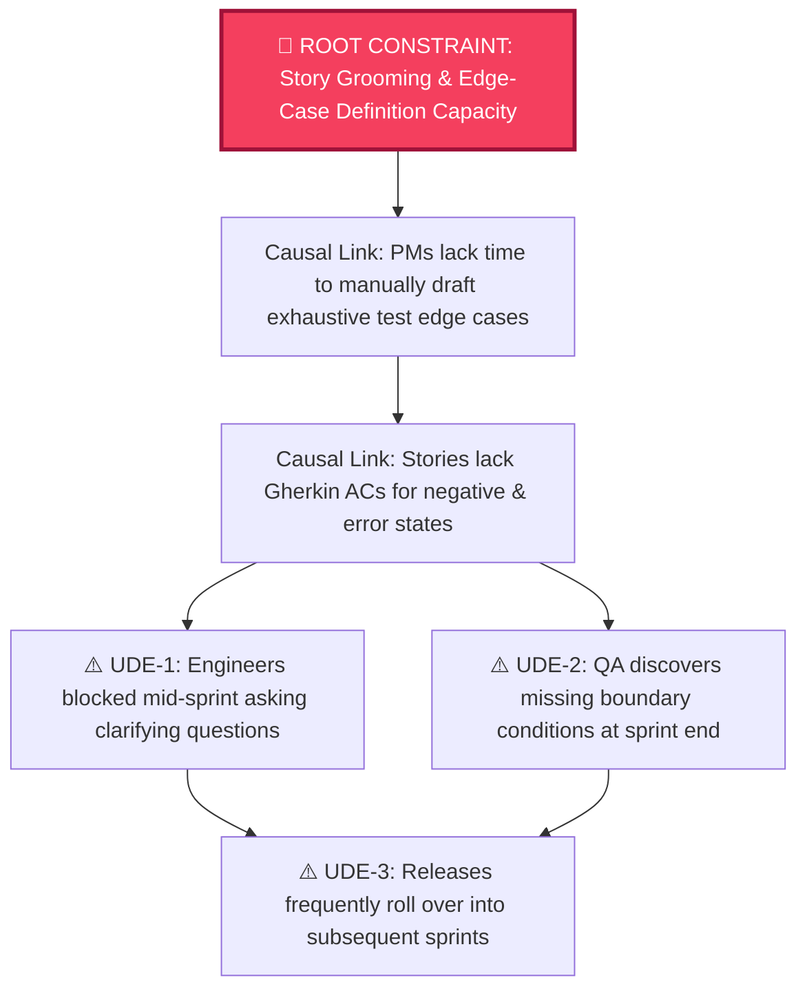

# ⚙️ Strategic Framework: Theory of Constraints (ToC) & CRT Mapping

## 1. 🧠 Mental Model & Trigger Conditions

### Theoretical Foundation
Formulated by **Dr. Eliyahu M. Goldratt** in *The Goal*, the Theory of Constraints (ToC) posits that any complex system’s rate of goal attainment (throughput) is strictly limited by a very small number of constraints—often **only a single bottleneck** at any given moment.

Optimizing any part of the product lifecycle other than the primary constraint produces an illusion of productivity (local optima) but yields **zero overall throughput improvement**, while drastically increasing work-in-progress (WIP) bloat and context-switching waste.

### Primary Purpose
To pinpoint the operational bottleneck choking product delivery, maximize throughput at that specific point, and align all upstream discovery and downstream execution to eliminate waste.

### Trigger Conditions
Apply this framework when:
- Engineering velocity stalls despite adding developers or running more meetings.
- Backlogs grow exponentially while sprint completion rates remain flat.
- Conducting sprint grooming, retrospective analysis, or operational reviews in `/refine-user-stories` or `/create-prd`.
- Prioritizing developer tool investments, workflow automation, or harness enhancements.

---

## 2. 📥 Required `.context/` Inputs & Socratic Questions

### Mandatory Context Inputs
- [`.context/product.md`](file:///home/marcin/Documents/Projects/ai-pm-sidekick/.context/product.md): North Star metric (*Time-to-Validated-Ready-Story*), supporting throughput metrics, and OKRs.
- [`.context/strategy-and-constraints.md`](file:///home/marcin/Documents/Projects/ai-pm-sidekick/.context/strategy-and-constraints.md): Current bottleneck state and team capacity limits.
- [`.context/conventions.md`](file:///home/marcin/Documents/Projects/ai-pm-sidekick/.context/conventions.md): Definition of Ready (DoR) and Definition of Done (DoD) gating criteria.

### Socratic Inquiry
The AI agent must interrogate the product delivery workflow using these questions:
1. **The Accumulation Test**: *"At which specific stage in the pipeline is unfinished work piling up in queues (e.g., raw ideas, unwritten PRDs, ungroomed stories, PR code reviews, QA validation, production deployment)?"*
2. **The Starvation Test**: *"Is our most constrained resource (e.g., senior engineers or QA) frequently idling or starved because upstream inputs arrive with missing details, ambiguous requirements, or unvalidated edge cases?"*
3. **The Subordination Check**: *"Are we speeding up an upstream activity (e.g., generating 50 user stories) that the downstream team cannot possibly consume within the sprint?"*
4. **The Root Conflict**: *"What fundamental organizational fear or false assumption prevents us from breaking this bottleneck?"*

---

## 3. ⚙️ Step-by-Step Execution & Scoring Rubric

### Phase 1: The 5 Focusing Steps

```
[1. Identify Constraint] ➔ [2. Exploit Constraint] ➔ [3. Subordinate Everything] ➔ [4. Elevate Constraint] ➔ [5. Prevent Inertia]
```

1. **Step 1: IDENTIFY the System Constraint**
   - Measure cycle time and queue sizes across: Discovery ➔ PRD ➔ Story Breakdown ➔ Grooming ➔ Development ➔ QA ➔ Release.
   - The constraint is the stage with the highest WIP inventory and longest waiting queue.
2. **Step 2: EXPLOIT the Constraint**
   - Ensure the bottleneck operates at 100% capacity on high-value items only.
   - Never feed defective inputs into the bottleneck: enforce strict Definition of Ready (DoR) gates with `/refine-user-stories` before stories enter engineering grooming.
   - Offload all non-essential administrative tasks away from the constrained resource.
3. **Step 3: SUBORDINATE Everything Else**
   - Pace all upstream skills to the throughput rate of the bottleneck (Drum-Buffer-Rope mechanism).
   - If engineering capacity is 5 stories per sprint, do not dump 30 stories into Jira; maintain a small, highly groomed 2-sprint buffer.
4. **Step 4: ELEVATE the Constraint**
   - Invest in tooling, automated Gherkin scaffolding, MCP synchronizers, or dedicated specialists to permanently increase capacity at the bottleneck.
5. **Step 5: PREVENT INERTIA (Repeat)**
   - As soon as the current constraint is broken, immediately locate the new bottleneck.
   - Never allow operational habits formed around the old constraint to dictate the new system.

---

### Phase 2: Current Reality Tree (CRT) Root-Cause Mapping
When diagnosing systemic friction, construct a Current Reality Tree using strict cause-and-effect logic:
- **Undesirable Effects (UDEs)**: Observable symptoms (e.g., "Stories returned from sprint mid-flight", "Sprint commitment missed by 35%").
- **Intermediate Causes**: Direct causal mechanisms connecting UDEs.
- **Root Constraint / Core Conflict**: The fundamental policy, assumption, or bottleneck responsible for $\ge 70\%$ of the downstream symptoms.

---

## 4. 📊 Output Format (Markdown Table & Mermaid Diagram)

### 1. Current Reality Tree (Mermaid)


### 2. ToC Operational Action Plan Table
```markdown
| Focusing Step | Target Constraint / Area | Action Taken | Throughput Metric Impact |
| :--- | :--- | :--- | :--- |
| **1. Identify** | Story Grooming Latency | Queue size = 28 stories waiting in backlog | Baseline wait time: 6.2 days |
| **2. Exploit** | Developer Grooming Time | Enforce 85%+ Grooming Score prior to meeting | Zero ungroomed tickets reviewed in meeting |
| **3. Subordinate**| PRD / Spec Ingestion | Cap active PRD drafting to 2 epics per squad | WIP reduced from 14 to 4 active specs |
| **4. Elevate** | Automated Story Refinement | Deploy `refine-user-stories` SPIDR splitting | Story authoring time cut from 4h to 20m |
| **5. Repeat** | New Bottleneck Detected | Shift focus to QA Automation / Staging CI | Monitored via weekly throughput metrics |
```

---

## 5. ✍️ `.context/` Write-Back Target

- **Target File**: [`.context/strategy-and-constraints.md`](file:///home/marcin/Documents/Projects/ai-pm-sidekick/.context/strategy-and-constraints.md)
- **Target Section**: `## ⚙️ 2. Theory of Constraints (ToC): Bottleneck Analysis`
- **Update Protocol**:
  1. Record the current system bottleneck and its verified queue metric.
  2. Document the specific exploitation and subordination rules active for the current cycle.
  3. Update the Current Reality Tree diagram when structural bottlenecks shift.
