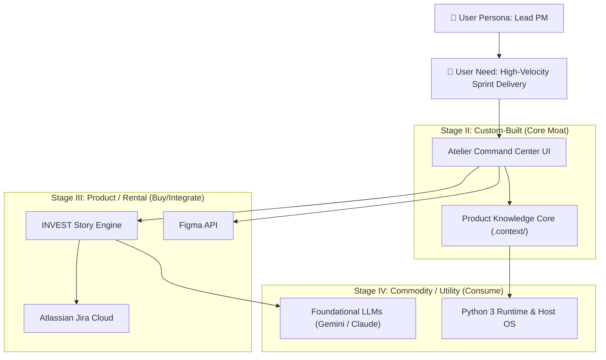

# 🗺️ Strategic Framework: Wardley Value Chain Mapping

## 1. 🧠 Mental Model & Trigger Conditions

### Theoretical Foundation
Developed by **Simon Wardley**, Wardley Mapping provides situational awareness and strategic gameplay by plotting a system's value chain along two axes:
- **Vertical Axis (Visibility)**: Proximity to the end customer (from high customer visibility at the top down to invisible foundational infrastructure at the bottom).
- **Horizontal Axis (Evolution)**: The maturity of each component moving through four stages:
  - **Stage I: Genesis** (Uncertain, novel, high failure rate, bespoke research).
  - **Stage II: Custom-Built** (Emerging practices, tailored in-house development, rapid iteration).
  - **Stage III: Product / Rental** (Standardized products, vendor competition, feature comparison, SaaS).
  - **Stage IV: Commodity / Utility** (Ubiquitous, highly standardized, plug-and-play utility pricing).

### Primary Purpose
To prevent catastrophic resource misallocation (e.g., custom-building commoditized components) and explicitly identify where a product's true competitive differentiation resides.

### Trigger Conditions
Apply this framework when:
- Evaluating **Build vs. Buy vs. Partner** decisions in PRDs or technical specs.
- Initiating a new product initiative or evaluating technical architecture in `/create-prd` or `/validate-idea`.
- An engineering or product team proposes building bespoke infrastructure (e.g., custom auth, custom workflow engines, internal LLM orchestrators).
- Aligning product roadmaps with industry-wide commoditization waves.

---

## 2. 📥 Required `.context/` Inputs & Socratic Questions

### Mandatory Context Inputs
- [`.context/product.md`](file:///home/marcin/Documents/Projects/ai-pm-sidekick/.context/product.md): Target personas, core value loops, and North Star metric.
- [`.context/strategy-and-constraints.md`](file:///home/marcin/Documents/Projects/ai-pm-sidekick/.context/strategy-and-constraints.md): Existing value chain components and business constraints.
- [`.context/architecture.md`](file:///home/marcin/Documents/Projects/ai-pm-sidekick/.context/architecture.md): Known tech stack, dependencies, and external integrations.

### Socratic Inquiry
The AI agent must challenge the PM and engineering proposals using these questions:
1. **The Anchor**: *"Who is the specific user, and what is their immediate, observable need at the top of the chain?"*
2. **Evolution Integrity**: *"Is this component genuinely a novel innovation (Genesis/Custom), or is there an existing commercial Product (Stage III) or cloud Utility (Stage IV) that solves 80% of it?"*
3. **The Core Moat**: *"Does building this component in-house create a durable competitive moat, or are we burning engineering capital on non-differentiating plumbing?"*
4. **Climatic Movement**: *"Which components in our architecture will be commoditized by major cloud providers or open-source tooling within the next 12–18 months?"*

---

## 3. ⚙️ Step-by-Step Execution & Scoring Rubric

### Step 1: Anchor on the User Need
Identify the primary persona and define their single most critical functional goal at the top of the chain (Visibility = 1.0).

### Step 2: Map the Direct & Indirect Dependencies
Trace downwards from the user need to list every supporting activity, data store, technology component, and capability required to satisfy it.

### Step 3: Assess the Evolution Stage of Each Component
Evaluate each component against Simon Wardley's evolution characteristics:

| Evaluation Dimension | Stage I: Genesis | Stage II: Custom-Built | Stage III: Product / Rental | Stage IV: Commodity / Utility |
| :--- | :--- | :--- | :--- | :--- |
| **Market Certainty** | Unexplored, chaotic | Emerging, bespoke | Competitive market | Well-defined, standardized |
| **User Understanding**| "What is this?" | "I built one for my needs" | "Which product should I buy?" | "It's just part of the background" |
| **Failure Rate** | Very high ($\ge 80\%$) | High ($\sim 50\%$) | Moderate ($\sim 10\%$) | Negligible ($< 1\%$) |
| **Cost Profile** | Unpredictable R&D | High developer labor | Fixed subscription / license | Volume utility billing (per unit) |

### Step 4: Apply the Build-vs-Buy-vs-Partner Doctrine
Apply the definitive Wardley doctrine rules:
- **Genesis / Custom (Stages I & II)**: **BUILD IN-HOUSE** only if it directly powers your core competitive advantage. Otherwise, **PARTNER** with specialized labs or open-source contributors.
- **Product / Rental (Stage III)**: **BUY OR LICENSE** commercial off-the-shelf software, managed SaaS, or established libraries. Never write custom code here unless modifying standard features is your core IP.
- **Commodity / Utility (Stage IV)**: **USE UTILITIES**. Rely strictly on cloud infrastructure, standardized APIs, and public utilities. Custom work here is pure technical debt.

---

## 4. 📊 Output Format (Markdown Table & Mermaid Diagram)

### 1. Visual Value Chain Map (Mermaid)


### 2. Value Chain Strategic Decision Table
```markdown
| Component | Visibility | Evolution Stage | Strategic Doctrine | Justification / Action |
| :--- | :--- | :--- | :--- | :--- |
| **[Component Name]** | High / Med / Low | Genesis / Custom / Product / Commodity | Build / Buy / Partner / Consume | [Rationale based on evolution & moat] |
```

---

## 5. ✍️ `.context/` Write-Back Target

- **Target File**: [`.context/strategy-and-constraints.md`](file:///home/marcin/Documents/Projects/ai-pm-sidekick/.context/strategy-and-constraints.md)
- **Target Section**: `## 🧭 1. Wardley Map: Value Chain Evolution Table`
- **Update Protocol**:
  1. Merge newly discovered components into the evolution table.
  2. If a proposed feature is classified as Stage III or IV, log an explicit build-vs-buy recommendation.
  3. If an architectural decision contradicts doctrine (e.g. custom building a commodity), flag a risk entry in `strategy-and-constraints.md` and log a corresponding record in [`.context/decisions.md`](file:///home/marcin/Documents/Projects/ai-pm-sidekick/.context/decisions.md).
